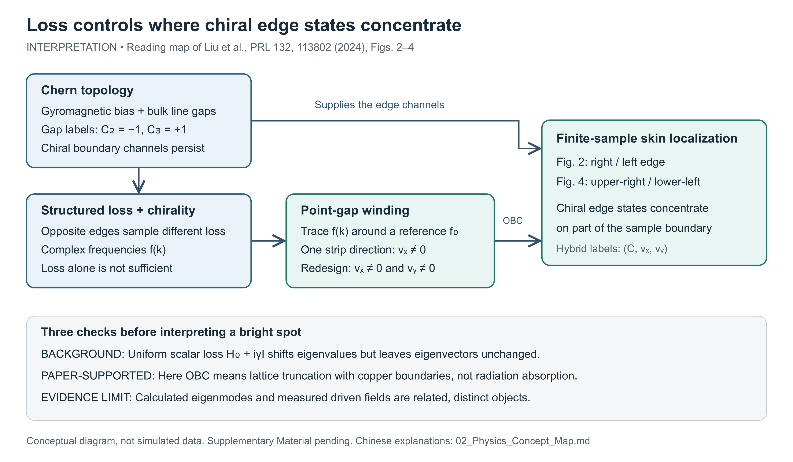

# 02 · Physics Concept Map

2026-09-27｜INTERNAL｜**材料已准备 / 待本人学习**

[可编辑 SVG](图件/制作源/concept_map.svg) / [矢量 PDF](图件/成品/concept_map.pdf)。这是助理绘制的 **INTERPRETATION** 关系图；蓝色路径概括 P1 Fig.2–4，底栏给 BACKGROUND 反例和证据限制，不是新计算结果。

## 只补本文需要的八个概念

| 概念 | BACKGROUND：最小含义 | PAPER-SUPPORTED：本文落点 |
|---|---|---|
| Bloch band / band gap | 周期结构按 k 分类本征模式；随 k 的本征频率构成能带。能隙是一定条件下体模谱的空缺 | 双 PBC 给体谱；Fig.2(b) 的蓝色区域和相邻 line gaps |
| Chiral edge state | 局限在边界附近、具有定向传播的通道；同一边界缺少可散射到的反向通道时，普通弹性回散受抑 | Fig.2(g) 上下边界空间分开，箭头标群速度；不是圆偏振的同义词 |
| Chern topology | 描述二维波矢空间本征态几何的整数拓扑指标；适用条件下，界面两侧 Chern 差关联净手性边缘支数 | 本文非厄米体系保留 line gaps，C₂=-1、C₃=+1；具体算法转引 SM |
| Non-Hermitian | 有效算符 H≠H†；耗散是来源之一，并非必需同时有增益。封闭无损体系的厄米描述也要用正确内积 | 本文来自材料损耗，并由旋磁偏置破坏时间反演；这两件事职责不同 |
| Complex spectrum | 本征频率 f=fᵣ+ifᵢ；实部关联振荡，虚部关联时间衰减/增长，符号取决于时间约定 | Fig.2(b,f,i)、Fig.4(b) 横轴 Re(f)、纵轴 Im(f)，单位 GHz |
| Point gap | 相对于参考复频率 f₀，整个所考察谱不穿过 f₀。多带写 det[H(k)-f₀I]≠0 | Eq.(1) 取环内 f₀；本文关心围绕它的非零绕行，不是仅仅“有个空点” |
| Point-gap winding | k 走完一维 BZ 后，f(k)-f₀ 的相位净变化除以 2π；是复频率平面上的绕行 | Fig.2(f) +1/-1，Fig.2(i) 0；ν 与 C 不是同一个数 |
| NHSE | 大量本征态因非厄米性和边界敏感性而向边界集中；需比较周期/截断条件，单个局域缺陷态不够 | 本文皮肤效应作用于原本的手性边缘态；Fig.2(d) 一侧，Fig.4(e,f) 角落 |

“鲁棒”不等于不衰减、不漏能、对任意破坏都不变。**BACKGROUND：** 若能隙关闭、远侧边缘耦合、强缺陷破坏条件，简单保护图像可能不适用。**PAPER-SUPPORTED：** P1 结论称其对局部缺陷具有优于既往 NHSE 实现的鲁棒性；具体缺陷测试在 S1，尚未直接核验。

## 复频率：先固定符号再解释衰减

**BACKGROUND（与本文图示一致的时间约定）。** 本包使用

\[
E(t)\propto e^{+i2\pi f t}=e^{+i2\pi f_r t}\,e^{-2\pi f_i t}.
\]

因此 fᵢ>0 表示振幅衰减，强度按 exp(-4πfᵢt) 衰减。若教材采用 exp(-iωt)，被动衰减的虚部符号相反。**PAPER-SUPPORTED，P1 p.3：** 作者把虚部较大的环上支对应到损耗更强的下边缘；图中 Im(f)>0 不应误说成增益。频率 f 与角频率 ω=2πf 也不要混用。

## 两种“绕”发生在不同空间

**BACKGROUND。** 厄米、孤立能带的一个常见表达是

\[
C=\frac{1}{2\pi}\int_{\mathrm{BZ}}\Omega(\mathbf k)\,d^2k,
\]

这里 Ω 是由本征态随 k 的变化构成的 Berry 曲率。这是解释 Chern 几何含义的最小公式，**不是本文色散非厄米 Maxwell 系统的计算配方**。本文相应定义/计算需 S1；不要求首轮推导。

**PAPER-SUPPORTED，P1 Eq.(1)：**

\[
\nu_{\alpha,n}=\oint_{\mathrm{BZ}}\frac{dk_\alpha}{2\pi i}
\frac{d}{dk_\alpha}\ln[f(k_\alpha)-f_0],\quad \alpha=x,y.
\]

α 是条带采用 PBC 的方向，n 是能隙编号，f₀ 是选定环内参考频率。此处考察的是**复本征频率轨迹**，不是实空间绕着样品走了几圈。多带一般定义会用行列式；首轮不要把此单条谱路径公式无条件套给任意交叉多带。

**BACKGROUND（手算练习，不是论文数据）。** 令 f(k)=f_c+r exp(ik)，k 从 0 到 2π，取 f₀=f_c，则 ν=+1；改成 exp(-ik) 得 -1；把 f₀ 移到圈外得 0。参考点不能落在谱上。可见 point gap 的存在与非零 winding 是两件事；“有复数谱”也不自动意味着绕圈。

## 损耗为何可以让边缘态局域，而不只是一路衰减

**PAPER-SUPPORTED，P1 p.3、Fig.2(f,g)。** 上、下边缘手性传播方向不同，所经损耗环境也不同，对应复谱不同虚部的分支；随 k 拼合为闭环。在有限边界条件下，同一结构产生集中一侧的本征态。换损耗图案可让两个方向都有绕数，得到角落局域。

**BACKGROUND（直觉，不充当证明）。** 可把边界想成带位置依赖损耗的单向通道。一个自洽的衰减本征模在空间不同位置具有不同幅度包络，使整体满足边界条件和共同的时间衰减率。归一化之后可在某处积累；这不要求被动材料放大总能量，也不等于“越有损的位置越亮”。真正判据仍应回到谱与本征态，而非此比喻。

**BACKGROUND（反例）。** 若 H₀u=fu，且只加 iγI，则 (H₀+iγI)u=(f+iγ)u；本征矢 u 未变。故均匀额外损耗可以只改变寿命。实际材料均匀增加损耗未必严格等同这个标量模型，所以该反例用来否定“损耗必然引起 NHSE”，不用来替代真实 Maxwell 计算。

## 本文的组合标签

**PAPER-SUPPORTED，P1 Eq.(3)、Fig.2 / Fig.4。**

| 结构 / gap | Cₙ | νₓ,ₙ | νᵧ,ₙ | 有限样品中的对应 |
|---|---:|---:|---:|---|
| Fig.2 / 2 | -1 | +1 | 0 | 右侧边界 |
| Fig.2 / 3 | +1 | -1 | 0 | 左侧边界 |
| Fig.4 / 2 | -1 | +1 | +1 | 右上角 |
| Fig.4 / 3 | +1 | -1 | -1 | 左下角 |

**INTERPRETATION。** 对这篇论文，可记为：C 说明边缘通道的拓扑来源，νₓ、νᵧ说明新增的空间聚集方向。不要把上表推广成所有非厄米二维体系的无条件定理。

出处：[P1 正式正文 pp.1–5](来源/paper_published.pdf)。BACKGROUND 为基础线性代数/波动与拓扑定义的教学补充，不声称作者逐句论证；可选深入入口是 P1 参考文献 13–15、24–25，**本轮未逐篇阅读，不作为已核读来源**。
