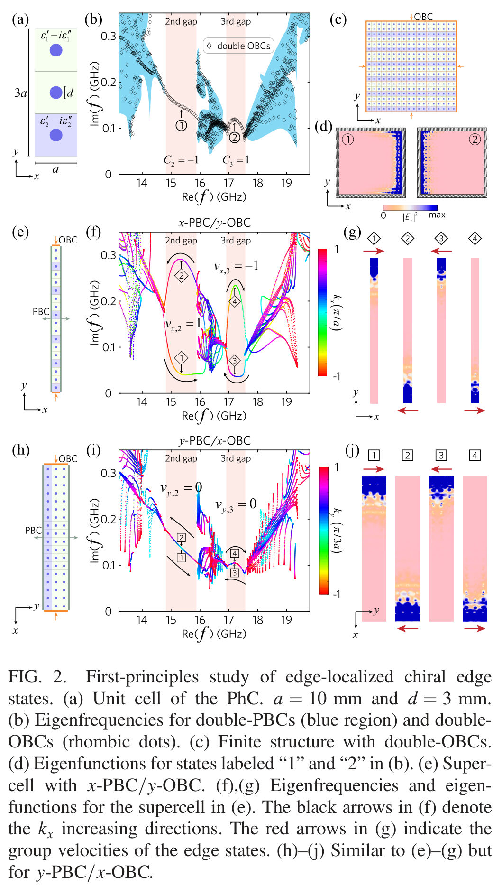
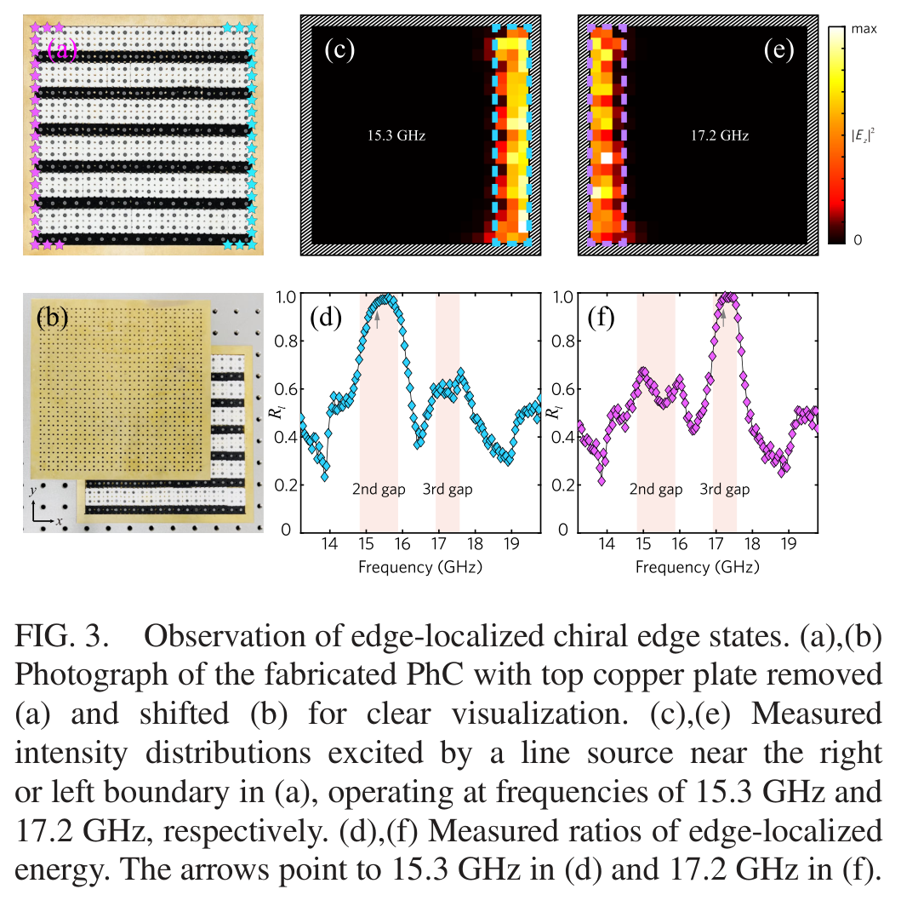
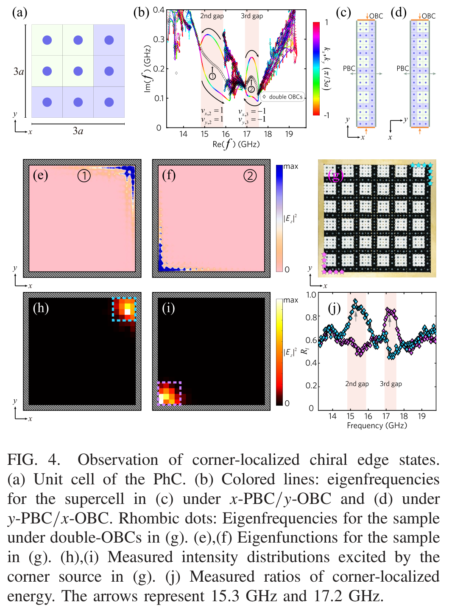

# 03 · Key Figures

2026-09-27｜INTERNAL｜**材料已准备 / 待本人学习**

三张图均从 [正式论文 P1](来源/paper_published.pdf) 原页裁剪，保留原图注；版权归原权利人，限本包内部研读。图注中 first-principles 指该电磁体系的直接数值研究，不是申请偏好中的电子结构 DFT。本文件的观察条目为 PAPER-SUPPORTED；读图顺序与证据边界为 INTERPRETATION。

## Fig.2：把复谱、绕数与有限样品本征态对应起来

[矢量裁剪 PDF](图件/成品/figure_2.pdf)，原文 p.2 图、p.3 解释。建议 8–12 分钟。

**PAPER-SUPPORTED。** 按 (a,c)→(b,d)→(e,f,g)→(h,i,j) 看：

| 面板 | 先读什么 | 能从图中得到什么 |
|---|---|---|
| a、c | a=10 mm，d=3 mm；三个旋磁柱及两种损耗包覆；有限样品铜边界 | 损耗有空间结构，x/y 不是等价方向。OBC 为晶格截断 |
| b | 横轴 Re(f)、纵轴 Im(f)，均 GHz；蓝色区为 double-PBC 体谱，菱形为 double-OBC 本征频率 | 有限样品在体谱 line gaps 中增加态；单看频率位置尚不能判断空间分布 |
| d | b 中标记 1、2 对应的 \|E_z\|²；色标 0→max | gap 2 态集中右侧，gap 3 集中左侧；不是实验数据 |
| e、f | x-PBC/y-OBC；颜色标 k_x，黑箭头标 k 增大；不是时间演化 | 两个 gap 的谱分别逆时针/顺时针绕行，νₓ,₂=+1、νₓ,₃=-1 |
| g | 四个编号态的位置与红色群速度箭头 | 上下边缘承载不同传播方向；下边缘损耗更强，对应较大 Im(f) |
| h、i、j | 换成 y-PBC/x-OBC；图中坐标也旋转，勿照搬上一行左右 | 没有相应谱环，νᵧ,₂=νᵧ,₃=0；与有限样品未聚到上/下侧相符 |

**INTERPRETATION：证据边界。** 这是本文最核心的一张图，给出模型、谱和本征场之间的对应。Fig.2(d) 本身不测绕数；Fig.2(f) 本身也不测实验。纵轴虚部不是吸收率，色条 k 不是场强；所谓“正绕数→右侧”在这里成立需附带作者的坐标与约定。

**自测（INTERPRETATION）：** 遮住答案，指出哪一图能反驳“Chern 数非零就必然发生角落局域”。要点：同样的非零 C 在 Fig.2 只有 νₓ 非零，态主要集中一侧；角落需要另看两个方向的绕行。

## Fig.3：实频驱动实验与一侧局域

[矢量裁剪 PDF](图件/成品/figure_3.pdf)，原文 p.3 图、pp.3–4 解释。建议 4–8 分钟。

**PAPER-SUPPORTED。** (a,b) 是样品照片；展示时移开/错开上铜板。(a) 星形标线源位置。作者逐个测量组成偶极源产生的场，再获得整个线源的场分布。(c,e) 分别对应右侧/左侧线源，在 15.3 / 17.2 GHz 展示 \|E_z\|² 分布；(d,f) 给出局域比例随频率变化。

**PAPER-SUPPORTED，P1 Eq.(2)：**

\[
R_l=\frac{\int_{\Pi_s}|E_z|^2\,dx\,dy}
{\int_{\Pi}|E_z|^2\,dx\,dy}.
\]

Π 是整个样品区域，Π_s 是所选边缘附近区域。(d,f) 横轴 GHz，纵轴 R_l 无量纲；各自目标能隙内比例较高。图中虚线框对应关注的局域区。

**BACKGROUND：** 上式直接定义的是电场强度的空间占比。虽然原文称其为能量局域比例，不能把它等同于色散旋磁介质中完整电磁储能的严格积分，更不能当成反射率 R 或吸收率 A。高 R_l 可以和总信号衰减同时存在。

**INTERPRETATION：证据边界。** 实验亮斑与预测模式分布相符；它是特定源驱动下的实频响应，不是无源本征模的直接快照，也不是整条复谱的实验测量。源位置本身会造成局域响应，因此论文还用了不同激励轮廓对照；其补图 S3、S4 尚未直接取得，幅相和归一化细节保持待核。

**自测（INTERPRETATION）：** 如果 R_l 接近 1，能否说“几乎 100% 的入射能量被吸收”？不能；这里的分母是样品区域的场强积分，不是入射功率。

## Fig.4：更换损耗图案，一侧变角落

[矢量裁剪 PDF](图件/成品/figure_4.pdf)，原文 p.4 图、pp.4–5 解释。建议 3–7 分钟。

**PAPER-SUPPORTED。** (a) 损耗单元在两个方向都不再保持原先的镜面对称。(b) 综合两种条带的复谱和有限样品菱形点；(c,d) 表示两种 PBC/OBC 条带。gap 2 的 νₓ=νᵧ=+1，gap 3 的 νₓ=νᵧ=-1；C₂=-1、C₃=+1 保持。(e,f) 计算本征态分别集中右上和左下；(g) 照片及角落源；(h,i) 15.3 / 17.2 GHz 的测量强度；(j) 相应角落区域的 R_l。

**INTERPRETATION：证据边界。** 这说明在作者研究的设计里，可以通过损耗图案改变局域位置，不必把 Chern 数变成另一个值。不能仅因出现角落亮斑，就把它叫成传统厄米高阶拓扑角态；本文强调的是 Chern 边缘通道与 NHSE 的结合。也不能据此宣称任意损耗图案均可指定任意位置。

**自测（INTERPRETATION）：** 哪两幅是计算，哪两幅是测量？(e,f) 是本征态计算；(h,i) 是受迫响应测量。为什么要一起看？前者避免把源附近亮斑直接误判为本征局域，后者检查模型与样品响应是否对应。

## 15–30 分钟复盘脚本

**INTERPRETATION。** 最短版按上面 8+4+3 分钟读；30 分钟版按 12+8+7 分钟，再花 3 分钟不看答案回答：①C 与 ν 有何区别；②损耗不必然产生 NHSE 的反例；③R_l 与吸收率的区别。只解释这三张图，不另扩补图课程。对 SM 的具体问题记录在 [Source Record](00_Source_Record.md)，不凭图像猜答案。
