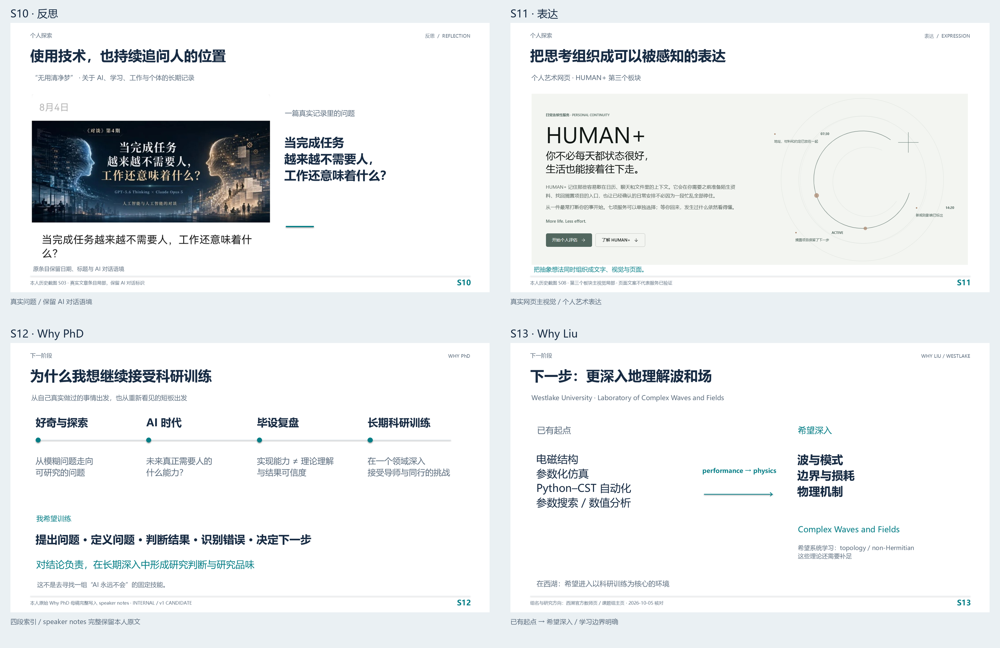
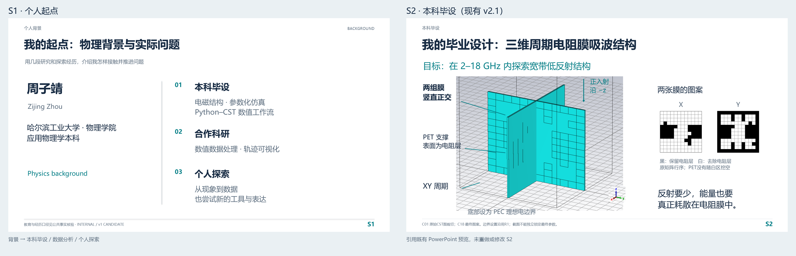

# 刘癸庚交流｜新增候选页联合审阅

2026-10-05｜**INTERNAL / v1 CANDIDATE**｜本轮只补页，等待本人和 Chat 审阅。

## 本轮实际交付

| 页 | 用途 | 实际文件 | 备注与来源 |
|---|---|---|---|
| S0 | 极简封面 | [PPTX](../S0_封面_v1_20261005/S0_封面_v1.pptx) / [PDF](../S0_封面_v1_20261005/S0_封面_v1.pdf) | [说明与备注](../S0_封面_v1_20261005/README.md) |
| S1 | 个人背景 / 起点 | [PPTX](../S1_个人背景_v1_20261005/S1_个人背景_v1.pptx) / [PDF](../S1_个人背景_v1_20261005/S1_个人背景_v1.pdf) | [说明与备注](../S1_个人背景_v1_20261005/README.md) |
| S10 | 反思 | [PPTX](../S10_反思_v1_20261005/S10_反思_v1.pptx) / [PDF](../S10_反思_v1_20261005/S10_反思_v1.pdf) | [说明与备注](../S10_反思_v1_20261005/README.md) |
| S11 | 表达 | [PPTX](../S11_表达_v1_20261005/S11_表达_v1.pptx) / [PDF](../S11_表达_v1_20261005/S11_表达_v1.pdf) | [说明与备注](../S11_表达_v1_20261005/README.md) |
| S12 | Why PhD | [PPTX](../S12_WhyPhD_v1_20261005/S12_WhyPhD_v1.pptx) / [PDF](../S12_WhyPhD_v1_20261005/S12_WhyPhD_v1.pdf) | [说明与备注](../S12_WhyPhD_v1_20261005/README.md) |
| S13 | Why Liu / Westlake | [PPTX](../S13_WhyLiu_v1_20261005/S13_WhyLiu_v1.pptx) / [PDF](../S13_WhyLiu_v1_20261005/S13_WhyLiu_v1.pdf) | [说明与备注](../S13_WhyLiu_v1_20261005/README.md) |

每份均为独立一页：可编辑PPTX、PowerPoint 16.0实际导出PDF、3840×2160及1920×1080 PNG、README、已嵌入备注、来源与保全、制作源。**没有S1–S13合并PPT**，也没有把旧S2–S9重新制作。

## 联合预览

- [S10–S13 联合审阅](预览/S10-S13_联合审阅.png)
- [S10–S11 双页审阅](预览/S10-S11_双页审阅.png)
- [S12–S13 双页审阅](预览/S12-S13_双页审阅.png)
- [S1 与既有 S2 衔接审阅](预览/S1-S2_衔接审阅.png)
- [拼图来源与哈希](预览来源.json)

预览是实际PowerPoint导出PNG的等比例拼接，供看叙事与视觉连续性，不是新的合并演示文件。S2直接引用既有v2.1预览字节，没有打开或改写旧PPT。

## 开始时的实际文件与版本状态

1. 本地起点 `9211a3f`，正确分支；PR #15 是 OPEN，autoMergeRequest 为 null。
2. 核对远端后发现三条仅新增主线/讲稿的提交；不与既有未提交资料冲突，已快进当前分支至 `2cff85ef2f2e7551d8e245a0b014fdeefcb41658`，再以新版完整主线和合并讲稿制作。
3. PPTX及文件检索确认：S2–S5 v2.1、S6、S7、S8、S9 A/B已有实际候选；S1/S10–S13没有实际候选。新版完整讲稿也明确S1尚待制作。
4. 未发现本次刘老师交流可复用正式封面。仓库中历史本科答辩PPT属于其他用途，不能当作本次交流封面。因此补一个可选、独立S0，不改内容页编号。
5. 三份既有未提交公共毕设资料不属于本轮，原样保留，不纳入提交。
6. 交付前远端又新增 `3d0ae36` 的[S13精修提案](../S13_WhyWestlake-Liu_精修建议_20261005.md)，已再次快进同步。它标为INTERNAL / PROPOSAL、尚待本人确认；本轮保留当前轻量候选，把“继续用工具服务于物理问题”的表述建议交本人和Chat仲裁，没有套入更长讲稿或未经本轮核验的定导培养陈述。

## 叙事与原稿优先级

以本人本轮指令优先：不合整套、不改S2–S9、不按旧8–9分钟删稿。旧设计文件中相冲突的合并步骤和秒数预算仅保留为历史记录。

新增页围绕“实际问题与工具起点 → 反思与表达 → 为什么长期训练 → 为什么向波动物理深入”接续。S12页面四段仅作路标，其本人原文在speaker notes逐行完整保留；S13主讲保持轻量，完整逻辑置于可展开备注。未改任何已有口述母稿或完整讲稿。

## 验收

- [最终交付核验](最终交付核验.json)：六份PPT/PDF独立单页、完整备注逐字比对、本地链接及来源保全通过；各页另有交付文件SHA-256清单。
- [PowerPoint渲染汇总](PowerPoint渲染汇总.json)：六份独立PPT均由Microsoft PowerPoint **16.0**实际打开，导出PDF/4K/1080p；文字溢出0、对象越界0。
- [人工视觉检查记录](人工视觉检查.md)：逐页查看实际1080p输出；页面比例、核心可辨性与连续性通过桌面预览检查。现场投影和本人试讲未实测。
- [制作前保全基线](制作前保全基线.json)：120份已有S2–S9文件、17份来源及3份无关未提交资料共140份，哈希保持。
- S10/S11裁切像素逐一与原图对比，PPT嵌入字节一致，图片比例无拉伸。
- 每页实际备注与本页Markdown一致；S12原文完整性检查为true。

## 本人与 Chat 的主要仲裁点

1. **S1** 的新口述是否像本人；三段入口是否自然引出S2。
2. **S10/S11** 的裁切、图文占比与两页“反思 → 表达”是否成立，避免被误听成运营/产品成果。
3. **S12** 四段索引能否支撑原文完整表达、被打断后接回；先标真实表达问题，不以估计时长删思想。
4. **S13** 轻量主述是否自然、理论学习边界是否明确；可选S0是否保留。
5. **后到的S13提案**：是否用“保留数值和AI工具，让其服务于更清楚的物理问题”调整当前候选的可展开备注。提案较长，且学校制度主张尚未进入本轮候选；待本人确认后另立版本，不覆盖本轮v1。

下一步由本人和Chat审完新增页，再决定新版本修订及整套合并。本轮候选不升级为final，不更改联系事件，不发送申请材料。PR #15继续OPEN / no auto-merge，不合并main。
