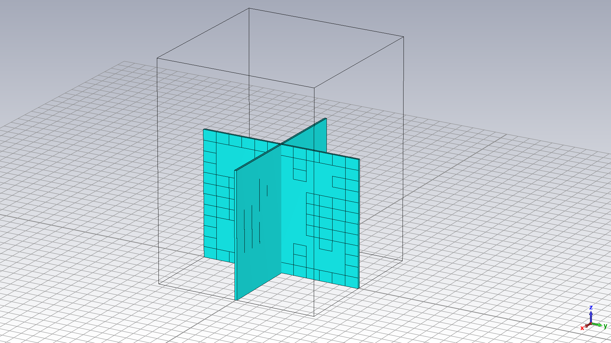

# 本科毕设 PPT 视觉素材筛选｜2026-10-05

状态：**INTERNAL｜素材考古与筛选完成，未制作最终PPT。** 适用：PR #15 当前分支 `chatgpt/liu-interview-plan-20261004`，中文交流准备的 S2／S3／S4。读取远端基线 `93c86fd`。推荐级别是“适合这一页的程度”，不等于材料READY或性能验证通过。

## 1. 先看推荐结论

- **S2第一主选：C01原始CST三维图。** 它是论文图6-2的原图，同字节存在于最终素材和旧PPT图件包。最终族归属有论文与可见图案支持；截图缺少参数栏，不能由截图独立锁定某次求解。X面显示不完整，优先搭配C18最终X/Y掩码，而不是补造线条。
- **S2第二候选：C01＋C02正交俯视组合。** 适合解释“竖直正交、XY周期”，仍需C18或口述解释具体图案；C02不能证明最终参数。
- **S2第三候选：C07现有结构＋展开图。** 最终数组对应强、X/Y清楚，但必须标“2026-09申请准备阶段据归档掩码绘制的结构示意”。它是现存复盘资产，不是历史CST截图；本轮未重画。
- **S3主组合：C12 → C15 → C16 → C17/C18。** 能恢复6×6母型、9×9、12×12固定片阻、连续双片阻到最终保存设计。早期条带/工字可选C10/C11补一个起点；最初手工单片和无图案PET试验缺乏可唯一绑定的图，不能用C08顶替。
- **S4主组合：C01结构小图＋C18双膜图案＋C24现成矢量曲线（定量源C22）。** 若要求全用历史原始图，则将C24换成C22原始PNG。结果固定写“保存的2–18 GHz扫描中，指定同模反射≤−10 dB的最长连续采样段4.80–18.00 GHz，端点跨度13.20 GHz”。

**未找到一张未经修订就能兼具全部标注、看清X/Y、且唯一绑定最终参数的现有图。** C05信息最全但h标注不符，C06图案不符；不能用“看起来完整”代替真实性。优先级是模型对应与可追溯性，其次才是美观。

## 2. 检索范围与读图深度

| 范围 | 实际处理 | 边界 |
|---|---|---|
| 仓库`科研准备/本科毕设/` | 图片文件、39份DOCX/4份PPTX的内嵌媒体；19份PDF登记与相关项目页选择性核读 | 597次图像出现，包含重复图、校徽、示意、引用图；不是597个独立科研结果 |
| `F:/biyesheji` | 只读遍历图像、PDF、DOCX/PPTX；77次图像出现，3份文档容器；最终工程伴随History补充核查 | 未打开CST或执行任何原科研/绘图脚本 |
| `E:/360MoveData/Users/zzj/OneDrive/桌面/毕业设计` | 只读遍历；519次图像出现、59份文档容器 | 外部两目录的图像及文档容器均找到仓库同SHA-256副本；本次范围没有发现需新增复制的独有图片/文档 |
| 三范围去重 | 共1193次图像出现，按SHA-256为193种图像；以联系缩略图通览，候选再放大核读 | DOCX/PPTX按媒体内容去重；PDF不混入这个图片计数，不声称逐张审完所有参考论文的PDF内嵌图 |
| 终稿论文 | 核对图3-1/3-2/3-3、5-7/5-9、6-2及Word媒体关系；视觉查看对应页和原图 | PDF物理页21、23、47、49、55等；正文页码比物理页少5。论文机理文字不是已验证事实的自动凭据 |
| 旧PPT | 按presentation关系表核实际页序、内嵌媒体SHA-256 | 中期17页；终稿20页。历史v2制作脚本只读，未运行，不能由脚本存在声称有v2成品 |
| R1/U02/U03与PR #15 | 读事实核验、源件索引、静态对应、当前研究物理主线；检查PI区已有项目页结构/曲线及教学图入口 | R1事实源优先；当前复习图、能量流向/路径差/Block2教学图不是历史项目图，不进入本轮S2–S4主选 |

另对全仓库按图像、PPT、PDF及“毕设/thesis/reflection/geometry”等路径进行定位；申请材料快照、旧项目页、教学图与其他科研项目分开，不把其他论文图作为本科毕设成果。压缩包未解包或上传。文档内校徽、签名、评语、文献背景图不纳入候选清单。全部原件未覆盖、未移动；检视缩略图和PDF页面渲染仅在临时审查目录，不作为新科研素材入库。

## 3. 最终版本的交叉核对

### 3.1 图案、尺寸、片阻和边界

最终保存身份：`最终结果ohmic_sheet_12x12_multitemplate_topology_ga`；p=13.1409 mm、h=10.0731 mm、PET厚0.188 mm、Rs,x=140.79 Ω/□、Rs,y=35.461 Ω/□。

本轮只解析既有文本，核对了原始最终工程`Model/3D/ModelHistory.json`的358个历史块中有关几何与材料的条目：36个X与79个Y像素的helper矩形坐标及create/delete链，和保存mask逐格相符；没有调用建模或求解。X膜在x–z面、y=0.094 mm；Y膜在y–z面、x=0.094 mm。边界块352为XY unit cell、Zmin electric、Zmax expanded open；配套角度记录为正入射。**PEC在此用底部理想电边界实现，不要求有一块可见的实体金属Brick。**

C01与图件包fig6_2的SHA-256均为`b4d3784cc300927978a10ef2c2d95ea2fdbfb16abccd56a7e224218acd569885`；终稿Word的`word/media/image28.png`也是该图。C01并非损耗场图，不能与图6-11混淆。论文称其最终12×12，且可见Y轮廓相容；但截图本身没有完整显示X膜或参数，不能证明捕获时正是13.20 GHz那次求解。**最终几何文本已对上，不等于截图所有细节或曲线运行配置已完全认证。**

方向特别注意：原始mask图按矩阵第0行在上展示；建模代码把第i行放在`z=i*h/12`，因此物理z向上时第0行在底部。C07按物理坐标展示，看起来上下翻转是有源映射的，不能为了统一美观任意翻转。白色/空白像素表示去除电阻层，不意味着PET也挖空。

### 3.2 最终曲线的可追溯口径

| 原始采样核对 | 结果 |
|---|---:|
| 扫描范围／输出点数／输出间隔 | 2–18 GHz／201点／0.08 GHz |
| 阈值前一个点 | 4.72 GHz，−9.733259 dB |
| 首个通过点 | 4.80 GHz，−10.042591 dB |
| 末个通过点／扫描上限 | 18.00 GHz，−10.268263 dB |
| 最长连续通过采样段端点差 | 18.00−4.80=13.20 GHz |
| 最小指定同模反射 | 14.24 GHz，−23.485400 dB |
| C24既有TSV与C22原数据 | 201组频率与dB值逐行完全一致 |

该检查是保存数据的一致性复核，没有新增物理仿真、没有画新曲线。18 GHz不是已找到的物理高频终点；201个输出点不等于201次独立求解；13.28 GHz点数估计不替换端点跨度13.20 GHz；82.5%只是频窗覆盖比。总吸收、多反射通道、频率/网格独立收敛继续UNKNOWN。

### 3.3 “看着一样”不能合并版本

hf获选mask、最终multitemplate获选mask和fixed_topology精修的固定mask相同，**但p/h/Rs、曲线和阶段不同**。quarter_symmetric更规整但属于最终之后未采用的分支。选择必须至少绑定“mask＋best_result＋曲线来源”，不能只挑同名`best_s11`或同样写13.20的文件。

静态核验明细与候选文件SHA-256见[核验附件](本科毕设_PPT视觉素材核验_20261005.json)，全量图像发现索引见[素材索引CSV](本科毕设_PPT视觉素材索引_20261005.csv)。索引I编号只表示发现顺序，不表示推荐或历史先后；正文C编号才是筛选候选。

## 4. 候选素材逐项记录

下列路径均从仓库根目录书写，并提供可点击相对链接。每项的处理建议供后续统一设计阶段使用，本轮未裁图、加标注或制作PPT。

### C01｜最终阶段 CST 原始三维视图

**文件路径：**

- [科研准备/本科毕设/图件/原始工程/report_figures/results/最终版素材/3D.png](<../../../科研准备/本科毕设/图件/原始工程/report_figures/results/最终版素材/3D.png>)
- [科研准备/本科毕设/原始文档/毕业设计原件/结题/终稿/_ppt_assets_resistive_film/fig6_2_final_3d_model.png](<../../../科研准备/本科毕设/原始文档/毕业设计原件/结题/终稿/_ppt_assets_resistive_film/fig6_2_final_3d_model.png>)

- **图片内容：** 1920×1080；两片竖直正交支撑、Y面像素边线、计算区域外框和坐标轴。两个文件SHA-256完全相同。
- **历史阶段／最终版本：** 论文图6-2（终稿PDF第55页，正文页50）明确归为最终12×12；可见Y轮廓与最终族相容。最终工程历史已逐格对应X36/Y79；截图自身无参数栏，不能进一步唯一鉴别hf、最终或固定图案精修的参数。
- **适用页／推荐级别：** S2；S4结构小图；**主选**。
- **推荐或排除原因：** 保留真实CST外观，来源最短；比概念图更适合说明实际建模对象。
- **后续裁切／标注／导出：** 后续裁去大片背景网格；保留坐标。根据源文件补“+z侧入射／沿−z传播”“XY周期”“PET”“片阻面”“z=0理想PEC边界”。X面遮挡严重时搭配C18，优于凭空补线。
- **UNKNOWN与不可推断：** 截图捕获工程、准确时刻、X面线条不全的原因UNKNOWN；截图没有清楚画出实体背板。地面网格不是PEC证据，外框顶面不是膜高h；不能由青色推断材料或片阻。

### C02｜最终素材中的正交俯视／底视方向图

**文件路径：**

- [科研准备/本科毕设/图件/原始工程/report_figures/results/最终版素材/3D_bottom.png](<../../../科研准备/本科毕设/图件/原始工程/report_figures/results/最终版素材/3D_bottom.png>)

- **图片内容：** 1920×1080；XY方向投影显示十字交叉与方形外框，膜边线很细。
- **历史阶段／最终版本：** 与最终3D同目录；俯视投影本身不展示12×12图案，最终参数不能由此单独认证。
- **适用页／推荐级别：** S2辅助；**备选**。
- **推荐或排除原因：** 适合补充两片膜为何正交、周期单元怎样投影；不宜单独承担主视觉。
- **后续裁切／标注／导出：** 后续裁到单元并保留方向标；严格核对是沿+z还是−z看，标p与周期方向。
- **UNKNOWN与不可推断：** 文件名bottom不证明有可见背板，也不能据图推断具体图案、片阻和尺寸。

### C03｜Y向膜的CST正视图

**文件路径：**

- [科研准备/本科毕设/图件/原始工程/report_figures/results/3D_Y.png](<../../../科研准备/本科毕设/图件/原始工程/report_figures/results/3D_Y.png>)

- **图片内容：** 1920×1080；可见Y面12格边框、内窗口及另一片膜的边缘。
- **历史阶段／最终版本：** 可见形态与最终/hf共用Y图案相容；缺参数栏，不能唯一归到13.20 GHz设计。
- **适用页／推荐级别：** S2辅助；S4核图；**备选**。
- **推荐或排除原因：** 比三维透视更容易检查Y面轮廓，但不能补出X面的全部像素。
- **后续裁切／标注／导出：** 裁去上方空气区及空白，保留z/y轴；需要与C18按物理z方向而非矩阵行号对照。
- **UNKNOWN与不可推断：** 准确工程及捕获时刻UNKNOWN；不因文件名写Y就推定某一极化或能量分工。

### C04｜论文图3-2：已加标注的CST外观图

**文件路径：**

- [科研准备/本科毕设/原始文档/毕业设计原件/结题/终稿/_ppt_assets_resistive_film/fig3_2_cst_model.png](<../../../科研准备/本科毕设/原始文档/毕业设计原件/结题/终稿/_ppt_assets_resistive_film/fig3_2_cst_model.png>)

- **图片内容：** 1448×1086；与C01外观相近，已标unit cell boundary、PET、patterned resistive film。
- **历史阶段／最终版本：** 论文中的说明性加工图；最终族外观相容，但不与C01同字节，未认证全部加工步骤。
- **适用页／推荐级别：** S2；**备选**。
- **推荐或排除原因：** 已有材料标签；较适合解释组成，但其X面仍遮挡，缺入射与PEC说明。
- **后续裁切／标注／导出：** 后续中文化并核对每条引线；与原始C01对照，不将加工图当未经处理的CST导出。
- **UNKNOWN与不可推断：** 制作方式与是否改动局部轮廓UNKNOWN；未直接显示最终片阻。

### C05｜论文图3-3：几何／边界总示意

**文件路径：**

- [科研准备/本科毕设/原始文档/毕业设计原件/结题/终稿/_ppt_assets_resistive_film/fig3_3_geometry_boundary.png](<../../../科研准备/本科毕设/原始文档/毕业设计原件/结题/终稿/_ppt_assets_resistive_film/fig3_3_geometry_boundary.png>)

- **图片内容：** 1448×1086；三维加俯视、入射、PET、PEC、周期、Floquet端口均有标注。
- **历史阶段／最终版本：** 说明性示意，不是最终工程原始截图。图中h箭头跨到上方端口平面，高于膜顶；与代码h=PET/膜高的定义不一致。
- **适用页／推荐级别：** S2检索候选；**不建议使用**。
- **推荐或排除原因：** 虽然单图信息最全，但h误标会直接误导模型解释；不能因漂亮和完整就选主图。
- **后续裁切／标注／导出：** 将来若使用须纠正h、中文标注，并明确PEC是边界示意；本轮不改图。
- **UNKNOWN与不可推断：** 灰色背板的实际厚度、端口高度、所有像素是否忠实来源均UNKNOWN；没有制造结构厚度证明。

### C06｜论文图3-1：彩色结构概念图

**文件路径：**

- [科研准备/本科毕设/原始文档/毕业设计原件/结题/终稿/_ppt_assets_resistive_film/fig3_1_design_concept.png](<../../../科研准备/本科毕设/原始文档/毕业设计原件/结题/终稿/_ppt_assets_resistive_film/fig3_1_design_concept.png>)

- **图片内容：** 1448×1086；两色交叉膜、PET、金属地、入射波与红色损耗箭头。
- **历史阶段／最终版本：** 概念图。可见两面窗口/边框与最终X36格、Y79格并不逐格一致，不是最终制造图。
- **适用页／推荐级别：** S2检索候选；**不建议使用**。
- **推荐或排除原因：** 不能用这张图代表最终设计；红箭头不是实际损耗分布。
- **后续裁切／标注／导出：** 若仅作概念背景，必须显著标“概念示意，非最终图案”；本轮优先C01，不把它改造成假CST图。
- **UNKNOWN与不可推断：** 绘图过程、具体原型及每个箭头的定量意义UNKNOWN。

### C07｜现成的最终掩码结构＋双膜展开图

**文件路径：**

- [A线_西湖博士/联系材料/刘癸庚/制作文件/项目页/第四版/图件/geometry.svg](<../../联系材料/刘癸庚/制作文件/项目页/第四版/图件/geometry.svg>)
- [A线_西湖博士/联系材料/刘癸庚/制作文件/项目页/第四版/图件/geometry.pdf](<../../联系材料/刘癸庚/制作文件/项目页/第四版/图件/geometry.pdf>)
- [A线_西湖博士/联系材料/刘癸庚/制作文件/项目页/第四版/图件/geometry.png](<../../联系材料/刘癸庚/制作文件/项目页/第四版/图件/geometry.png>)

- **图片内容：** 现有矢量源及1431×542 PNG；正交结构、X/Y展开、片阻、p/h、PET与金属背板说明。
- **历史阶段／最终版本：** 2026-09-27申请准备阶段据最终保存数组重绘，属于后期复盘model-derived示意；不是本科阶段CST截图，也不是本轮新图。
- **适用页／推荐级别：** S2备选；S4图案展示；**备选**。
- **推荐或排除原因：** 本轮核对展开图SVG像素ID与原始mask完全一致；模型历史对应115格。比C01更清楚显示X面，并保留物理长宽比。
- **后续裁切／标注／导出：** 若后续采用，保留“结构示意/据归档mask绘制”；补入射和周期标签，将“金属背板”准确写作理想PEC边界示意。不能去掉来源性质。
- **UNKNOWN与不可推断：** 投影、配色、底板外观是示意；不是样件、不是软件重导出，也不能修复或认证C01的遮挡原因。

### C08｜早期简单十字模型三视图PDF

**文件路径：**

- [科研准备/本科毕设/图件/原始工程/report_figures/structure/structure_3d.pdf](<../../../科研准备/本科毕设/图件/原始工程/report_figures/structure/structure_3d.pdf>)
- [科研准备/本科毕设/图件/原始工程/report_figures/structure/structure_top.pdf](<../../../科研准备/本科毕设/图件/原始工程/report_figures/structure/structure_top.pdf>)
- [科研准备/本科毕设/图件/原始工程/report_figures/structure/structure_side.pdf](<../../../科研准备/本科毕设/图件/原始工程/report_figures/structure/structure_side.pdf>)

- **图片内容：** 三张CST打印图，均可见完整实体十字；页脚标示08非等厚-非等高/best_design.cst。
- **历史阶段／最终版本：** 早期学习模型；对应保存模型History为GAOSHANG的film1/film2、非等厚/非等高与Zmin electric。不是最终PET＋Ohmic Sheet。
- **适用页／推荐级别：** S3早期背景；**备选**。
- **推荐或排除原因：** 可以真实展示曾经较简单的模型，但不能用来填充尚未定位的“最早无图案PET试验”。
- **后续裁切／标注／导出：** 仅选3D图并裁掉打印页眉空白，保留源路径于图注；标“早期学习模型，材料与正式模型不同”。
- **UNKNOWN与不可推断：** 打印时间不是研究起始时间；与最初手工单片试验的关系、是否全历史最早UNKNOWN。

### C09｜无PEC早期学习阶段截图

**文件路径：**

- [科研准备/本科毕设/原始文档/毕业设计原件/中期/结果/01（4×4）noPEC/01-12.75-1.35-4.52.png](<../../../科研准备/本科毕设/原始文档/毕业设计原件/中期/结果/01（4×4）noPEC/01-12.75-1.35-4.52.png>)

- **图片内容：** CST结果窗口，含多条Zmin/Zmax散射曲线和film1/film2树。
- **历史阶段／最终版本：** U02确认的无PEC学习阶段线索；与后来已有电边界的C08分开。
- **适用页／推荐级别：** S3备用背景；**不建议使用**。
- **推荐或排除原因：** 结构不突出、曲线过密，且不是最终问题边界；不能承担S2或S4。
- **后续裁切／标注／导出：** 若追问时使用，仅截模型树与相关端口说明，不把曲线当最终结果。
- **UNKNOWN与不可推断：** 同名完整工程及准确材料、与其他早期学习模型先后顺序UNKNOWN。

### C10｜条带模板三维截图

**文件路径：**

- [科研准备/本科毕设/图件/原始工程/report_figures/structure/条带.png](<../../../科研准备/本科毕设/图件/原始工程/report_figures/structure/条带.png>)
- [科研准备/本科毕设/图件/原始工程/数据存档/14基本-60-拓扑1.2/条带.png](<../../../科研准备/本科毕设/图件/原始工程/数据存档/14基本-60-拓扑1.2/条带.png>)

- **图片内容：** 890×642与786×619；两片PET/膜结构上有简单条带。
- **历史阶段／最终版本：** 薄实体膜/低自由度模板阶段；中期PPT第8页与中期报告记录条带→工字→6×6的叙事。不是无图案覆盖膜。
- **适用页／推荐级别：** S3；**备选**。
- **推荐或排除原因：** 可作正式PET电阻膜结构演化的简洁起点。
- **后续裁切／标注／导出：** 两图择一；裁背景并标“条带模板”；不要给截图套用最终p/h/Rs。
- **UNKNOWN与不可推断：** 两张具体捕获工程和运行时刻、是否恰为某个best_result UNKNOWN；不能按文件名或复制时间排序。

### C11｜工字模板三维截图

**文件路径：**

- [科研准备/本科毕设/图件/原始工程/report_figures/structure/工字.png](<../../../科研准备/本科毕设/图件/原始工程/report_figures/structure/工字.png>)
- [科研准备/本科毕设/图件/原始工程/数据存档/14基本-60-拓扑1.2/工字.png](<../../../科研准备/本科毕设/图件/原始工程/数据存档/14基本-60-拓扑1.2/工字.png>)

- **图片内容：** 688×636与733×628；工字形/开口结构的立体外观。
- **历史阶段／最终版本：** 薄实体膜模板探索，中期PPT第8页记录；早期源码有X=60/Y=80固定组合，不是后期连续双Rs。
- **适用页／推荐级别：** S3；**备选**。
- **推荐或排除原因：** 与条带并列说明从低自由度模板扩展至像素图案；不必在短页中全部塞入。
- **后续裁切／标注／导出：** 保留一张并标“工字模板”；图案形态与固定材料档位分开表述。
- **UNKNOWN与不可推断：** 截图精确材料配置、哪一次运行和具体参数UNKNOWN；“双片阻”不能笼统说到最终才首次出现。

### C12｜6×6条带＋阶梯窗口母型

**文件路径：**

- [科研准备/本科毕设/图件/原始工程/数据存档/14基本-60-拓扑1.2/电阻膜图案.png](<../../../科研准备/本科毕设/图件/原始工程/数据存档/14基本-60-拓扑1.2/电阻膜图案.png>)

- **图片内容：** 3301×1849；X中央两行连续条带，Y外框与阶梯状窗口；蓝保留、灰移除。
- **历史阶段／最终版本：** 已核薄实体6×6较优母型，p=13.281、h=8.8571；两组3×3种子由U02及best_result支撑。非最终12×12。
- **适用页／推荐级别：** S3；**主选**。
- **推荐或排除原因：** 是“纺锤形镂空＋条带”回忆最稳妥的现有视觉锚点，两种特征分别在Y/X膜上。
- **后续裁切／标注／导出：** 保留X/Y与蓝灰图例；可标“6×6像素，条带＋阶梯窗口”；“纺锤形”为回忆形容，不能补画连续光滑轮廓。
- **UNKNOWN与不可推断：** 不能认证这就是本人第一次看到该形态的那一次；像素继承不等于已验证共振机理。

### C13｜6×6母型的三维视图

**文件路径：**

- [科研准备/本科毕设/图件/原始工程/数据存档/14基本-60-拓扑1.2/侧视图.png](<../../../科研准备/本科毕设/图件/原始工程/数据存档/14基本-60-拓扑1.2/侧视图.png>)

- **图片内容：** 697×617；文件虽叫侧视图，实际为带透视的交叉结构截图。与中期PPT第6/9页图同字节。
- **历史阶段／最终版本：** 6×6薄实体阶段；中期文档与C12成组，不是最终12×12。
- **适用页／推荐级别：** S3辅助；**备选**。
- **推荐或排除原因：** 将二维窗口/条带连接到实际立体模型。
- **后续裁切／标注／导出：** 裁掉背景，图注按实际“透视图”写，不照抄文件名；保持历史版本标签。
- **UNKNOWN与不可推断：** 截图自身不显示具体材料值；不能据视觉推断完整底边界或制造结果。

### C14｜拓扑1.1的俯视＋6×6方案示意

**文件路径：**

- [科研准备/本科毕设/图件/原始工程/数据存档/13基本-60-拓扑1.1/current_design_schematic.png](<../../../科研准备/本科毕设/图件/原始工程/数据存档/13基本-60-拓扑1.1/current_design_schematic.png>)

- **图片内容：** 俯视十字示意及两组6×6矩阵；灰色表示保留，与C12颜色语义不同。
- **历史阶段／最终版本：** 较早方案说明；非C12母型的同一组mask，非最终模型。
- **适用页／推荐级别：** S3检索候选；**不建议使用**。
- **推荐或排除原因：** 会与C12的可靠母型混淆，且不能仅按13/14目录编号推定完整先后。
- **后续裁切／标注／导出：** 若需要恢复分支，先和同目录best_result逐格核对再用；本轮不插入主链。
- **UNKNOWN与不可推断：** 示意是否为该轮实际获选结果、制作时间与精确继承关系UNKNOWN。

### C15｜9×9两张独立膜图案

**文件路径：**

- [科研准备/本科毕设/图件/原始工程/report_figures/results/9×9ph/final_9x9_x_pattern_paper.png](<../../../科研准备/本科毕设/图件/原始工程/report_figures/results/9×9ph/final_9x9_x_pattern_paper.png>)
- [科研准备/本科毕设/图件/原始工程/report_figures/results/9×9ph/final_9x9_y_pattern_paper.png](<../../../科研准备/本科毕设/图件/原始工程/report_figures/results/9×9ph/final_9x9_y_pattern_paper.png>)

- **图片内容：** 分别给出X两侧保留区域与Y外框/窗口；图面标p=13.18 mm、h=8.866 mm、Rs=60 Ω/□。
- **历史阶段／最终版本：** 9×9 p/h微扰阶段，未到连续双片阻；图案继承证据见U02。
- **适用页／推荐级别：** S3；**主选**。
- **推荐或排除原因：** 补上6×6到12×12之间的真实图案，适合成对摆放。
- **后续裁切／标注／导出：** 两张一起用；保留X/Y说明；注意图中行号方向不是物理z向上，不擅自镜像。
- **UNKNOWN与不可推断：** 6×6→9×9严格逐像素自动映射UNKNOWN；不能把这一跳写成精确上采样，也不能仅凭Rs标题证明实际求解设置。

### C16｜12×12 hybrid：仍固定公共片阻

**文件路径：**

- [科研准备/本科毕设/图件/原始工程/ohmic_sheet_12x12_hybrid_coverage85_ga/best_mask_xy_12x12.png](<../../../科研准备/本科毕设/图件/原始工程/ohmic_sheet_12x12_hybrid_coverage85_ga/best_mask_xy_12x12.png>)

- **图片内容：** 2306×1234；X/Y图案组合，比9×9更细。
- **历史阶段／最终版本：** U02/U03定位hybrid保存阶段，OPTIMIZE_RS=False、Rs=60；有9→12映射和种子继承。
- **适用页／推荐级别：** S3；**主选**。
- **推荐或排除原因：** 准确显示“图案先加细”与“片阻随后连续化”是不同动作。
- **后续裁切／标注／导出：** 后续简化标题为“12×12／固定60 Ω/□”；保留X/Y，不用coverage85文件名作为已达到85%的证据。
- **UNKNOWN与不可推断：** 更细图案不等于更细求解网格；性能变化不是分辨率的单因素因果结论。

### C17｜12×12 hf：连续双片阻阶段

**文件路径：**

- [科研准备/本科毕设/图件/原始工程/ohmic_sheet_12x12_hf_compensation_ga/best_mask_xy_12x12.png](<../../../科研准备/本科毕设/图件/原始工程/ohmic_sheet_12x12_hf_compensation_ga/best_mask_xy_12x12.png>)

- **图片内容：** 2337×1234；X不对称局部块与Y窗口骨架；标题含high-frequency compensation。
- **历史阶段／最终版本：** 已核连续双Rs阶段，保存142.198/38.599 Ω/□；其mask与最终获选两张mask相同，最终尺寸/片阻不同。
- **适用页／推荐级别：** S3；**主选**。
- **推荐或排除原因：** 连接材料自由度扩展与最终图案；明确不是最后一轮又发现了新拓扑。
- **后续裁切／标注／导出：** 可与C18只展示一次共用图案，用参数文字指出阶段差异；高频补偿只是历史命名，勿当已验证机制。
- **UNKNOWN与不可推断：** 开连续片阻的首次建议者和准确决定时间UNKNOWN；无单因素对照，不能把13.12→13.20归因于图案变化。

### C18｜最终原始X/Y掩码图

**文件路径：**

- [科研准备/本科毕设/图件/原始工程/最终结果ohmic_sheet_12x12_multitemplate_topology_ga/best_mask_xy_12x12.png](<../../../科研准备/本科毕设/图件/原始工程/最终结果ohmic_sheet_12x12_multitemplate_topology_ga/best_mask_xy_12x12.png>)

- **图片内容：** 2380×1234；最终12×12二值图案，X36格、Y79格；黑保留、白去除。
- **历史阶段／最终版本：** 已确认最终保存multitemplate结果；mask TXT、结果元组、CST历史115个坐标逐项一致。
- **适用页／推荐级别：** S3末端；S4；S2辅助；**主选**。
- **推荐或排除原因：** 最终图案的最短可追溯来源，能补C01的X面不可读问题。
- **后续裁切／标注／导出：** 可后续拆成X/Y两图并补黑白图例；若保留矩阵形式不标物理z。要与CST并排按物理坐标展示，须根据i→z=i*h/12映射另作明确说明。
- **UNKNOWN与不可推断：** 图案不证明采购、加工或全极化；不得因X断成两块就推断模型失效或独立共振模式。

### C19｜论文排版的最终图案

**文件路径：**

- [科研准备/本科毕设/原始文档/毕业设计原件/结题/终稿/_ppt_assets_resistive_film/fig5_7_final_topology.png](<../../../科研准备/本科毕设/原始文档/毕业设计原件/结题/终稿/_ppt_assets_resistive_film/fig5_7_final_topology.png>)

- **图片内容：** 2652×1274；论文图5-7/6-1，旧答辩PPT第15页使用。
- **历史阶段／最终版本：** 最终图案的论文版，与C18形态对应但不同字节，原始C18优先。
- **适用页／推荐级别：** S4；S3末端；**备选**。
- **推荐或排除原因：** 版式较宽、便于追溯论文图号；没有增加新的结果证据。
- **后续裁切／标注／导出：** 保留X/Y并说明矩阵行序；不得将旧论文关于两片膜机理分工的文字一并作为已验证结论搬入。
- **UNKNOWN与不可推断：** 重新排版的具体导出过程UNKNOWN；与原始图的尺寸差不表示更高模型分辨率。

### C20｜最终之后的四分之一镜像分支

**文件路径：**

- [科研准备/本科毕设/图件/原始工程/ohmic_sheet_12x12_quarter_symmetric_ga/best_mask_xy_12x12.png](<../../../科研准备/本科毕设/图件/原始工程/ohmic_sheet_12x12_quarter_symmetric_ga/best_mask_xy_12x12.png>)
- [科研准备/本科毕设/图件/原始工程/ohmic_sheet_12x12_quarter_symmetric_ga/best_quarter_xy_6x6.png](<../../../科研准备/本科毕设/图件/原始工程/ohmic_sheet_12x12_quarter_symmetric_ga/best_quarter_xy_6x6.png>)

- **图片内容：** 对称化完整12×12图与四分之一6×6种子。
- **历史阶段／最终版本：** 最终13.20之后的独立未采用分支；保存12.64 GHz，U02确认相对继承，日志不完整。
- **适用页／推荐级别：** S3备用分支；**不建议使用**。
- **推荐或排除原因：** 对称、规整不代表最终；不应放在演化主链终点代替C18。
- **后续裁切／标注／导出：** 如备用追问用，标“后续未采用分支”，不要纳入主链的升级箭头。
- **UNKNOWN与不可推断：** 完整迭代完成情况、获选结果准确运行时间UNKNOWN；不能证明对称化一般更差。

### C21｜固定最终图案的低频精修分支

**文件路径：**

- [科研准备/本科毕设/图件/原始工程/ohmic_sheet_12x12_fixed_topology_lf_refine/fixed_mask_xy_12x12.png](<../../../科研准备/本科毕设/图件/原始工程/ohmic_sheet_12x12_fixed_topology_lf_refine/fixed_mask_xy_12x12.png>)
- [科研准备/本科毕设/图件/原始工程/ohmic_sheet_12x12_fixed_topology_lf_refine/best_s11_ohmic_sheet_12x12.png](<../../../科研准备/本科毕设/图件/原始工程/ohmic_sheet_12x12_fixed_topology_lf_refine/best_s11_ohmic_sheet_12x12.png>)

- **图片内容：** 与最终同mask，但另有一条不同曲线。
- **历史阶段／最终版本：** 最终之后固定图案、调p/h/Rs；保存同为13.20 GHz，却是p=13.0902、h=10.25072、Rs=156.5991/36.4988。
- **适用页／推荐级别：** S3/S4检索候选；**不建议使用**。
- **推荐或排除原因：** 同带宽和同图案仍可能是不同模型；不能和最终参数拼成一组。
- **后续裁切／标注／导出：** 若放备用需完整写分支名与参数，不把同名best_s11拿来替换C22。
- **UNKNOWN与不可推断：** 后期日志失败不等于物理失效；本轮不补全运行历史、不认定进一步提升。

### C22｜最终原始2–18 GHz同模反射曲线

**文件路径：**

- [科研准备/本科毕设/图件/原始工程/最终结果ohmic_sheet_12x12_multitemplate_topology_ga/best_s11_ohmic_sheet_12x12.png](<../../../科研准备/本科毕设/图件/原始工程/最终结果ohmic_sheet_12x12_multitemplate_topology_ga/best_s11_ohmic_sheet_12x12.png>)
- [科研准备/本科毕设/仿真结果/原始工程/最终结果ohmic_sheet_12x12_multitemplate_topology_ga/best_s11_ohmic_sheet_12x12.txt](<../../../科研准备/本科毕设/仿真结果/原始工程/最终结果ohmic_sheet_12x12_multitemplate_topology_ga/best_s11_ohmic_sheet_12x12.txt>)
- [科研准备/本科毕设/仿真结果/原始工程/最终结果ohmic_sheet_12x12_multitemplate_topology_ga/best_result_ohmic_sheet_12x12.txt](<../../../科研准备/本科毕设/仿真结果/原始工程/最终结果ohmic_sheet_12x12_multitemplate_topology_ga/best_result_ohmic_sheet_12x12.txt>)

- **图片内容：** 原始PNG＋201行频率/幅度/dB数据＋结果摘要；含−10 dB虚线。
- **历史阶段／最终版本：** 最终保存multitemplate结果。已从原数据核对4.80–18.00 GHz连续采样段、端点跨度13.20 GHz。
- **适用页／推荐级别：** S4；**主选**。
- **推荐或排除原因：** 直接支撑用户要求的结果口径，不依赖读图估算。
- **后续裁切／标注／导出：** 后续添加4.80–18.00和13.20 GHz标记，纵轴精确写指定同模反射；保留2–18窗口与−10 dB，18标扫描上限。
- **UNKNOWN与不可推断：** 全反射通道、总吸收率、独立收敛和更细采样边界UNKNOWN；不以线段插值声称精确物理起始频率。

### C23｜论文图5-9的最终曲线

**文件路径：**

- [科研准备/本科毕设/原始文档/毕业设计原件/结题/终稿/_ppt_assets_resistive_film/fig5_9_final_rl_curve.png](<../../../科研准备/本科毕设/原始文档/毕业设计原件/结题/终稿/_ppt_assets_resistive_film/fig5_9_final_rl_curve.png>)

- **图片内容：** 2080×1248；论文最终曲线、−10 dB虚线，旧答辩第15页使用。
- **历史阶段／最终版本：** 最终结果的论文重绘版本，最小值与趋势和原数据相符；C22是定量依据。
- **适用页／推荐级别：** S4；**备选**。
- **推荐或排除原因：** 干净完整，可以沿用，但没有C24的现成矢量编辑便利。
- **后续裁切／标注／导出：** 把Reflection Loss说明为指定同模反射，并补采样区间；图中旧用语不升级为总吸收。
- **UNKNOWN与不可推断：** 未认证历史绘图流程中每个点的渲染处理；不凭曲线外观判断网格或归一化。

### C24｜现有项目页的可编辑反射曲线

**文件路径：**

- [A线_西湖博士/联系材料/刘癸庚/制作文件/项目页/第四版/图件/reflection.svg](<../../联系材料/刘癸庚/制作文件/项目页/第四版/图件/reflection.svg>)
- [A线_西湖博士/联系材料/刘癸庚/制作文件/项目页/第四版/图件/reflection.pdf](<../../联系材料/刘癸庚/制作文件/项目页/第四版/图件/reflection.pdf>)
- [A线_西湖博士/联系材料/刘癸庚/制作文件/项目页/第四版/图件/reflection.png](<../../联系材料/刘癸庚/制作文件/项目页/第四版/图件/reflection.png>)
- [A线_西湖博士/联系材料/刘癸庚/制作文件/项目页/第四版/数据/reflection_archived.tsv](<../../联系材料/刘癸庚/制作文件/项目页/第四版/数据/reflection_archived.tsv>)

- **图片内容：** 矢量SVG/PDF及PNG，纵轴Co-polar reflection (dB)，2–18 GHz和−10 dB虚线。
- **历史阶段／最终版本：** 2026-09-27后期复盘数据图；本轮核对其输入TSV与C22原TXT的201组频率/dB逐行完全一致，静态脚本直接连原点。
- **适用页／推荐级别：** S4；**主选**。
- **推荐或排除原因：** 可作为正式中文PPT后续排版首选曲线载体；科学来源仍引用C22，不是新增仿真。
- **后续裁切／标注／导出：** 中文化坐标和采样范围标注；保持原201点、不平滑、不延长到18 GHz以外。原文件本轮不改。
- **UNKNOWN与不可推断：** 现有脚本data路径因历史整理已失效；不能直接运行原脚本覆盖输出。该图不提供全通道或新收敛验证。

### C25｜论文多阶段反射叠图和性能柱图

**文件路径：**

- [科研准备/本科毕设/原始文档/毕业设计原件/结题/终稿/_ppt_assets_resistive_film/fig5_10_stage_curves.png](<../../../科研准备/本科毕设/原始文档/毕业设计原件/结题/终稿/_ppt_assets_resistive_film/fig5_10_stage_curves.png>)
- [科研准备/本科毕设/原始文档/毕业设计原件/结题/终稿/_ppt_assets_resistive_film/fig5_11_bandwidth_comparison.png](<../../../科研准备/本科毕设/原始文档/毕业设计原件/结题/终稿/_ppt_assets_resistive_film/fig5_11_bandwidth_comparison.png>)
- [科研准备/本科毕设/原始文档/毕业设计原件/结题/终稿/_ppt_assets_resistive_film/fig5_12_coverage_comparison.png](<../../../科研准备/本科毕设/原始文档/毕业设计原件/结题/终稿/_ppt_assets_resistive_film/fig5_12_coverage_comparison.png>)
- [科研准备/本科毕设/原始文档/毕业设计原件/结题/终稿/_ppt_assets_resistive_film/fig5_13_min_rl_comparison.png](<../../../科研准备/本科毕设/原始文档/毕业设计原件/结题/终稿/_ppt_assets_resistive_film/fig5_13_min_rl_comparison.png>)

- **图片内容：** 各阶段多曲线叠加，以及带宽、覆盖率、最小反射比较。
- **历史阶段／最终版本：** 历史汇总；R1已记录薄体/Ohmic对照图源差异、早期与后期指标定义不同。
- **适用页／推荐级别：** S3/S4检索候选；**不建议使用**。
- **推荐或排除原因：** 本轮重点是设计演化与最终结果；大拼图易暗示全阶段已公平对照、单一变量导致提升。
- **后续裁切／标注／导出：** 如以后确需比较，先统一原数据和阈值定义，逐条核图；当前不搬整组图。
- **UNKNOWN与不可推断：** 跨阶段同参数可比性与因果归属UNKNOWN；82.5%不是吸收率。

### C26｜环形分辨率演化示意

**文件路径：**

- [科研准备/本科毕设/原始文档/毕业设计原件/结题/终稿/_ppt_assets_resistive_film/fig4_3_resolution_expansion.png](<../../../科研准备/本科毕设/原始文档/毕业设计原件/结题/终稿/_ppt_assets_resistive_film/fig4_3_resolution_expansion.png>)

- **图片内容：** 6×6→9×9→12×12三个规则环形图；旧答辩PPT第12页使用相应版本。
- **历史阶段／最终版本：** 一般设计空间示意，非C12/C15/C18真实获选图案。
- **适用页／推荐级别：** S3检索候选；**不建议使用**。
- **推荐或排除原因：** 容易让观众以为环形就是本人实际演化链；不能替代已有真实mask。
- **后续裁切／标注／导出：** 当前不用；若以后解释抽象编码须显著标示意，与项目结果分开。
- **UNKNOWN与不可推断：** 画面不存在真实阶段几何/参数对应，不能从箭头推出实际时间线。

### C27｜最终电／磁／损耗场图组

**文件路径：**

- [科研准备/本科毕设/图件/原始工程/report_figures/results/最终版素材/e-field (f=8.8) [Zmax(1)].png](<../../../科研准备/本科毕设/图件/原始工程/report_figures/results/最终版素材/e-field (f=8.8) [Zmax(1)].png>)
- [科研准备/本科毕设/原始文档/毕业设计原件/结题/终稿/_ppt_assets_resistive_film/fig6_7_hfield_12p0.png](<../../../科研准备/本科毕设/原始文档/毕业设计原件/结题/终稿/_ppt_assets_resistive_film/fig6_7_hfield_12p0.png>)
- [科研准备/本科毕设/原始文档/毕业设计原件/结题/终稿/_ppt_assets_resistive_film/fig6_11_loss_15p5.png](<../../../科研准备/本科毕设/原始文档/毕业设计原件/结题/终稿/_ppt_assets_resistive_film/fig6_11_loss_15p5.png>)

- **图片内容：** 代表性E/H和表面损耗场；有矢量箭头或颜色标尺，部分呈周期复制单元。
- **历史阶段／最终版本：** 最终族场分析素材；R1已核后期加监视器/自适应，但与GA导出曲线关系尚未逐点闭合。
- **适用页／推荐级别：** S4备用，非S2主图；**不建议使用**。
- **推荐或排除原因：** 场箭头/色图遮住结构；当前没有足够机制核验支撑用它解释具体宽带机制。
- **后续裁切／标注／导出：** 以后用于追问应保留频率、激励、单位、色标；不能裁成“纯结构图”，不能把W/m²图叫体损耗。
- **UNKNOWN与不可推断：** 各图和具体求解配置绑定、积分损耗、模式分工UNKNOWN；多复制面不等于实物阵列。

### C28｜早期稿的“实验／示例曲线”

**文件路径：**

- [科研准备/本科毕设/原始文档/毕业设计原件/结题/s11_experiment_reference_guide.docx](<../../../科研准备/本科毕设/原始文档/毕业设计原件/结题/s11_experiment_reference_guide.docx>)
- [科研准备/本科毕设/原始文档/毕业设计原件/结题/毕业设计初稿1.0.docx](<../../../科研准备/本科毕设/原始文档/毕业设计原件/结题/毕业设计初稿1.0.docx>)

- **图片内容：** 蓝仿真与红Experimental example/Measured minimum标注的曲线；前者word/media/image1.png、image2.png，后者image11.png。
- **历史阶段／最终版本：** 方案/示意，不是已归档测量数据；U03明确没有完成样品与实测闭环。
- **适用页／推荐级别：** S4检索候选；**不建议使用**。
- **推荐或排除原因：** 不能作为实验结果，也不能通过裁掉example字样再使用。
- **后续裁切／标注／导出：** 无适合本次主讲的修饰方式，直接排除。
- **UNKNOWN与不可推断：** 原始实测数据、仪器设置与样件均无支持；不能补成验证证据。

### C29｜历史中期答辩整套PPT

**文件路径：**

- [科研准备/本科毕设/原始文档/毕业设计原件/中期/中期答辩.pptx](<../../../科研准备/本科毕设/原始文档/毕业设计原件/中期/中期答辩.pptx>)

- **图片内容：** 17张；第6/9页有C13，第8页条带/工字，第9页6×6图案，第10/11页结果与控制台。
- **历史阶段／最终版本：** 薄实体6×6阶段的呈现记录；内嵌图媒体已与原图哈希对应。封面日期不作为运行时间。
- **适用页／推荐级别：** S3溯源；**备选**。
- **推荐或排除原因：** 提供条带/工字/6×6相对叙事顺序，并能找到可复用原图；整页不直接搬用。
- **后续裁切／标注／导出：** 只提取原图；避开旧带宽口径、计划性的实验/机制表述。
- **UNKNOWN与不可推断：** 实际答辩使用哪一版本、图件制作时刻UNKNOWN；PPT页序不是全部实验的时间线。

### C30｜历史终稿答辩PPT／PDF

**文件路径：**

- [科研准备/本科毕设/原始文档/毕业设计原件/结题/终稿/2022112550_ZhouZijing_Thesis_Defense_PPT.pptx](<../../../科研准备/本科毕设/原始文档/毕业设计原件/结题/终稿/2022112550_ZhouZijing_Thesis_Defense_PPT.pptx>)
- [科研准备/本科毕设/原始文档/毕业设计原件/结题/终稿/2022112550_ZhouZijing_Thesis_Defense_PPT.pdf](<../../../科研准备/本科毕设/原始文档/毕业设计原件/结题/终稿/2022112550_ZhouZijing_Thesis_Defense_PPT.pdf>)

- **图片内容：** PPT实际20张（部分页脚仍写16）；第1页C01，第4页C06，第5页C05，第12页环形示意，第15页最终图案＋曲线，第16页场图。
- **历史阶段／最终版本：** 终稿呈现资产；按PPT关系表实际页序查验，不按脚本预期位置推定。
- **适用页／推荐级别：** S2/S3/S4溯源；**备选**。
- **推荐或排除原因：** 可恢复图件来源与既有组合；优先取独立原图，避免整页缩图。
- **后续裁切／标注／导出：** 仅复用图件；不照搬旧的总吸收或模式解释措辞；脚本v2存在不证明另一个v2成品已生成/发送。
- **UNKNOWN与不可推断：** 实际现场使用版本UNKNOWN；结尾评语/签名不作为视觉候选、不复制到本次材料。

### C31｜材料横截面／产品表

**文件路径：**

- [科研准备/本科毕设/原始文档/毕业设计原件/结题/终稿/_ppt_assets_resistive_film/fig3_5_resistive_film_cross_section.png](<../../../科研准备/本科毕设/原始文档/毕业设计原件/结题/终稿/_ppt_assets_resistive_film/fig3_5_resistive_film_cross_section.png>)
- [科研准备/本科毕设/原始文档/材料参考/ITO导电膜产品资料表_本人提供_20260930.jpg](<../../../科研准备/本科毕设/原始文档/材料参考/ITO导电膜产品资料表_本人提供_20260930.jpg>)

- **图片内容：** 一般电阻膜横截面说明与本人提供历史产品表。
- **历史阶段／最终版本：** 材料说明/参考证据；前者不是最终模型精确截面，后者支持早期商品膜档位，不支持最终连续片阻已可购买。
- **适用页／推荐级别：** S2/S3备用说明；**不建议使用**。
- **推荐或排除原因：** 对S2结构主视觉帮助有限；容易把概念涂层厚度与0.188 mm PET混淆。
- **后续裁切／标注／导出：** 如备用追问只取相关行并保留表头、出处限制；不称最终成品规格。
- **UNKNOWN与不可推断：** 厂家/日期、采购与最终140.79/35.461可制造性UNKNOWN。

### C32｜旧薄实体与Ohmic模型对照

**文件路径：**

- [科研准备/本科毕设/原始文档/毕业设计原件/结题/终稿/_ppt_assets_resistive_film/fig3_4_model_curve_comparison.png](<../../../科研准备/本科毕设/原始文档/毕业设计原件/结题/终稿/_ppt_assets_resistive_film/fig3_4_model_curve_comparison.png>)
- [科研准备/本科毕设/图件/原始工程/branch1_surface_ohmic_sheet_comparison_v6/comparison_overlay_RL.png](<../../../科研准备/本科毕设/图件/原始工程/branch1_surface_ohmic_sheet_comparison_v6/comparison_overlay_RL.png>)

- **图片内容：** 两种膜表示的双曲线；论文版和成对比较版谷值不同。
- **历史阶段／最终版本：** 6×6模型表示核验阶段；R1明确论文Ohmic曲线来自X种子不同的片阻1.1分支。
- **适用页／推荐级别：** S3备用核验；**不建议使用**。
- **推荐或排除原因：** 不适合当“只换膜模型后的性能变化”主证据；不能和最终结果混用。
- **后续裁切／标注／导出：** 后续若讲模型表示差异，须从成对原参数、结果与工程重新核对，不能只修图例。
- **UNKNOWN与不可推断：** 论文为何选用不同来源曲线UNKNOWN；不自动定性为实验或算法错误。

## 5. S2三种候选怎样取舍

| 候选组合 | 三维/正交 | PET与片阻面 | PEC | 入射/周期 | 最终绑定程度 | 决定 |
|---|---|---|---|---|---|---|
| C01原始CST，必要时配C18 | 清楚，但X图案遮挡 | 要依据源码补标 | 原图不可见；从z=0边界证据补标 | 有轴/框，需补文字箭头 | 论文最终归属＋可见Y相容；截图参数绑定UNKNOWN | **第一主选**；真实性最容易交代 |
| C01＋C02 | 三维＋正交投影互补 | 仍需补标 | 同上 | 俯视便于标XY周期 | C02仅辅助，不提高参数认证等级 | **第二候选**；适合解释周期单元关系 |
| C07既有据mask示意 | 清楚，另有无遮挡X/Y | 已分色并写PET | 仅示意平面 | 需补入射/周期 | 最终mask与尺寸可追溯；属于后期复盘表达 | **第三候选**；须允许使用明确标性质的现存示意 |

如果只许单图且坚持历史原始CST，选C01，但承认其需补标且X面看不全。不要为了凑齐单图要求改选C05/C06。S2讲的是“结构与物理问题”，其完整性可由原图＋少量源件支持的标注承担，不必把所有精确像素在S2讲完。

原图直达：

## 6. S3可恢复的设计演化链

| 层次与素材 | 可以确认的连接 | 不可越过的断点 |
|---|---|---|
| 早期简单学习模型C08；无PEC截图C09另列 | 有过实体十字及不同底边界学习阶段 | 不把二者按图片目录先后排序；最初单片、无图案PET独立评价图仍未定位 |
| 条带C10／工字C11 | 中期PPT第8/9页与报告支持低自由度模板→6×6的研究叙事 | 单张截图准确时间/参数UNKNOWN；“无图案”不能由看似满色PET推定 |
| **C12：6×6薄实体较优母型** | X中央条带、Y阶梯窗口，保存种子与原图一致；转Ohmic存在种子继承 | “纺锤”是形容，不是圆滑几何；薄体→sheet不是只换标签，论文对照图源差异不能忽略 |
| **C15：9×9图案** | U02定位6×6尺寸继承、9×9种子及保存图案 | 6→9严格自动像素映射未找到；用“继承较好形态继续探索”，不用“逐像素等比例升级” |
| **C16：12×12 hybrid** | 9→12明确中心采样映射与母本注入；片阻仍固定60 | 不能写此处已经启用连续双片阻 |
| **C17：hf连续双Rs** | hybrid获选mask写入hf；实际材料与候选记录共同支持双片阻变化 | hf的Y固定、X扰动与最终Y骨架保护不是同一约束；不要称都完全自由 |
| **C18：最终multitemplate** | hf获选mask写入BEST82；最终mask未变，尺寸/片阻变为最终值 | 13.12→13.20不能画成新拓扑带来的提升 |
| 后续fixed/quarter | U02/U03已证明最终之后的继承尝试 | 不纳入“越来越好”的主链；不把更规整的quarter当最终 |

**最简素材组合是C12＋C15双图＋C16＋C18；C17与C18共用形态，可只展示一次图案并用两组参数注明连续双片阻/末段微调。** 若页数空间允许，再在左侧加一张C10或C11；不能为填“最早无图案”而生成新图或错用学习模型。这里安排的是有证据的相对研究阶段，不是以复制时间拼出来的绝对日期表。

## 7. S4最终结构与结果组合

1. **结构：** C01，图注称“论文最终阶段CST视图”，不称“本轮重跑验证截图”；若必须看清每一格，搭配C18。
2. **图案：** C18原始X/Y图；后续允许使用复盘资产时，可直接复用C07的两个物理方向展开面板。C19仅作排版备选。
3. **曲线：** 中文正式PPT排版优先C24现有矢量；保留数据源C22。若强调历史原图，用C22原PNG；C23论文版为备选。
4. **主结果：** 4.80–18.00 GHz、端点跨度13.20 GHz；图下简注“指定同模反射／0.08 GHz输出采样／18 GHz为扫描上限”。不标“实测”“总吸收率超过90%”。
5. **不一起搬入：** C21不同参数的同带宽曲线、C25跨阶段柱图、C27未经闭合的模式分工、C28实验示意。

## 8. 还缺哪些真实导出图

以下只列补件任务，不在本轮启动CST、重算或改原件。已有素材足以选定方向，但还不够做一张无歧义的单图主视觉。

| 优先级 | 后续从哪里补 | 具体图像要求 | 必须保留的核对凭据 |
|---|---|---|---|
| P1 | 最终归档CST的独立工作副本 | **纯几何透视图**：区分两张PET与两组Ohmic Sheet，令X/Y图案同时可读；保留单元边界、坐标轴，隐藏无关背景网格 | p=13.1409、h=10.0731、PET=0.188、Rs=140.79/35.461；和原mask逐格比对。不能用AI补线修复遮挡 |
| P1 | 同一副本 | **X面沿法向正投影＋Y面沿法向正投影**，分别导出；必要时暂时隐藏另一片，仅改变显示 | 标明观察方向、物理z向上；验证36/79格，记录哪一侧涂覆。现有C03仅提供Y可见轮廓 |
| P1 | 同一副本的边界/材料设置 | 一张内部核验截图：XY unit cell、Zmin electric、Zmax端口、theta/phi及两片材料阻抗 | 用来支持主视觉的PEC/入射/周期标注，不把设置窗口作为主PPT画面 |
| P2 | 同一副本 | 更干净的俯视周期单元；必要时周期显示复制2×2/3×3，但必须标“周期显示复制” | 不改变原单元/不新增阵列物理仿真；原模型文件哈希与显示操作记录分开 |
| P2 | 历史文件或已定位历史工程副本 | 无图案PET正式阶段的三维图（若能找到确切best_result/History） | 找不到就保留UNKNOWN；不要用GAOSHANG学习十字冒充，也不倒造最初单片图 |
| 无需补求解 | C22已有TXT、C24已有SVG | 后续只做中文坐标/阈值采样段标注即可 | 本轮已核201点来源。若要验证总吸收或收敛，是另外的科研验证任务，不是此次视觉补导出 |

最终归档工程只读定位：`F:/biyesheji/最终结果ohmic_sheet_12x12_multitemplate_topology_ga/best_design_ohmic_sheet_12x12.cst`；伴随文本在同名无扩展名目录。后续应先复制到独立工作目录，再仅做显示和导出；不能重新运行原GA覆盖保存结果。

## 9. 证据入口、验收与交接

事实仍以公共核验为准，本记录只维护素材判定与引用，不另建申请人事实母版：

- [公共资料/事实核验/毕设与新增个人证据核验_20260926.md](<../../../公共资料/事实核验/毕设与新增个人证据核验_20260926.md>)
- [公共资料/事实核验/本科毕设R1_20260930/核验记录.md](<../../../公共资料/事实核验/本科毕设R1_20260930/核验记录.md>)
- [公共资料/事实核验/本科毕设R1_20260930/U02_回忆与源文件续核.md](<../../../公共资料/事实核验/本科毕设R1_20260930/U02_回忆与源文件续核.md>)
- [公共资料/事实核验/本科毕设R1_20260930/U03_制造判断与片阻时间线.md](<../../../公共资料/事实核验/本科毕设R1_20260930/U03_制造判断与片阻时间线.md>)
- [公共资料/事实核验/本科毕设R1_20260930/对照图来源核查.md](<../../../公共资料/事实核验/本科毕设R1_20260930/对照图来源核查.md>)
- [公共资料/事实核验/本科毕设R1_20260930/U02_静态对应.json](<../../../公共资料/事实核验/本科毕设R1_20260930/U02_静态对应.json>)
- [A线_西湖博士/联系材料/刘癸庚/制作文件/项目页/第四版/说明.md](<../../联系材料/刘癸庚/制作文件/项目页/第四版/说明.md>)
- [A线_西湖博士/联系材料/刘癸庚/制作文件/项目页/第四版/figure-plan.md](<../../联系材料/刘癸庚/制作文件/项目页/第四版/figure-plan.md>)

本轮验收：32项候选逐项包含路径、内容、阶段、适用页、级别、理由、处理建议和UNKNOWN；图片/文档同字节映射与最终mask/History/曲线完成静态核对；推荐未依赖新示意图、新仿真或未经支持的年代排序。后续统一视觉设计时，先选S2第一组合，再决定是否补导出；本轮不设计页面、不生成最终PPT、不扩大申请/联系任务。

提交前检查：32项中主选8项、备选12项、不建议使用12项；记录内文件链接全部可达。对发现索引中的独立图像及原始文档容器共381个文件再次核对SHA-256，未发现源件变化；候选附件哈希亦一致。

提交范围仅本记录、核验附件、发现索引与A线/刘老师入口接续。原有三份未提交公共毕设资料保留，不纳入本次提交。按本人授权推送PR #15，保持OPEN、不自动合并。
