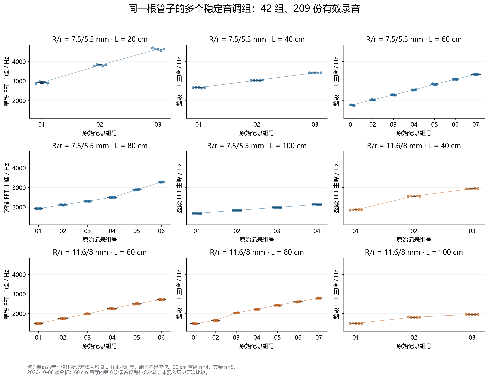
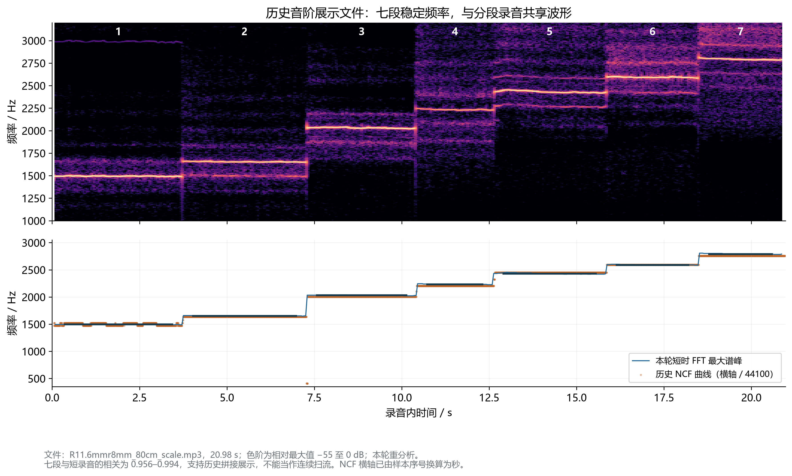
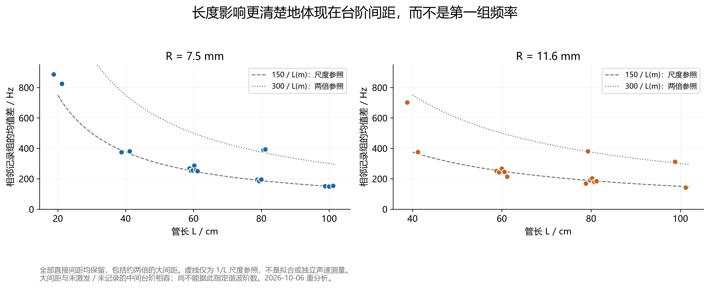
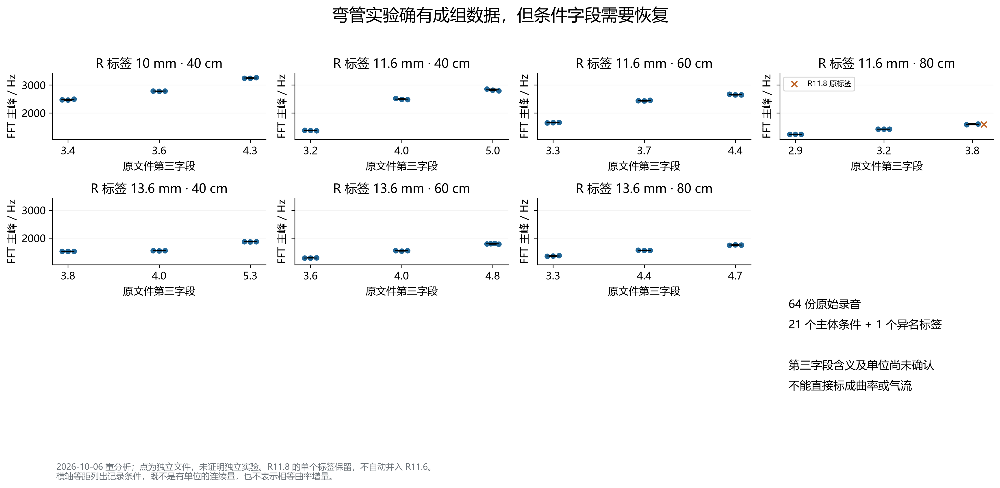

# 乐音研究｜音调台阶与几何影响深挖报告

2026-10-06｜INTERNAL｜历史材料再调查 + 本轮全量重分析，供本人和 Chat 审阅。

**这次调查应当修正上一版的叙事重心：你的项目不只是“重复录音后测到稳定主峰”，而是在研究同一波纹管的多个稳定音调，以及这些音调之间的间距如何受几何条件影响。** 历史分组数据、长度比较图、时变音高 FIG 和一份长录音共同支持这条主线。长度效应已有相当清楚的数据；截面尺寸比较有实证，但尚不能拆成单个半径的因果效应；弯管实验有完整成组录音，曲率字段仍需恢复。

本报告补充并更新[10 月 5 日考古报告](乐音研究_历史内容与独立贡献考古_20261005.md)中关于科学内容的判断，不覆盖旧报告。原件、既有 S7 和整套 PPT 均未由本轮修改。这里的新统计、时频图和尺度分析是 **2026 年重分析**，不能倒写成大二时已经完成的定量论证。

## 1. 结论先行：哪些已经找回，哪些还没有

| 命题 | 本轮判断 | 主要依据与边界 |
|---|---|---|
| 同一几何条件可以产生多个稳定音调 | **强支持** | 9 个有完整历史分表的几何条件、42 个音调组；同组集中、组间分离 |
| 一份历史录音中包含依次升高的多个稳定频率段 | **直接支持，但为同源展示证据** | `R11.6mmr8mm_80cm_scale.mp3` 约 20.98 秒，七段与已有短录音逐段高度匹配，强支持历史拼接展示；历史 FIG 与其对应 |
| 气流渐强时出现音调台阶 | **本人本轮明确回忆 + 分组音频现象相容** | 用户明确说明项目目标与现象。尚缺组号—供气操作映射、流速/流量记录；拼接展示文件不能充当连续扫流或已校准的 f–U 曲线 |
| 管长影响台阶间距 | **较强数据支持** | R/r=7.5/5.5 mm 的 40、60、100 cm 数据直接给出约 378、262、151 Hz 的平均间距；与近似 1/L 尺度相容 |
| 截面尺寸影响可观察音调序列 | **支持比较层面的差异** | 两族 R/r 在相同管长有不同频率集合和间距分布；不能把同组号视为同一模态，也不能只归因于内半径 |
| 整根管弯曲／局部波纹曲率的定量效应 | **有实验支线，定量关系未恢复** | 弯管目录 64 份音频；第三字段 2.9–5.3 的物理含义与单位未知，弯曲半径/角度和其他控制条件未找到 |
| 已经解释发声机制、完成可靠仿真验证 | **不支持** | COMSOL 建模和求解尝试属实，可靠实验对应与机制验证仍缺失 |

**上一版“最强证据只在单次主峰、组内重复性”过于保守，漏掉了成组台阶、历史音阶整理和跨长度间距这一层。** 但“不能直接指定谐波阶数、不能声称已验证机制”的边界仍然成立。

## 2. 本轮调查覆盖与证据口径

核心原件根目录为 `E:/2023/traindata`；FFT 原码在 `E:/matlab/work`，COMSOL 原工程在 `E:/COMSOL 6.2/test`。原路径、字节散列和历史来源仍以[既有证据索引](乐音研究_考古证据_20261005/README.md)为准。

本轮不再只抽查 15 段：

- 对 **821 个音视频文件按字节去重，得到 351 份内容**，全部成功解码并计算频谱；其中 346 份音频、5 份视频。文件数量不等于独立实验次数。
- 可解析为直管标签的 256 份：两族完整数据 211 份，另一个 R10 族 45 份。其中完整数据包含 1 份明确标记无效的文件、1 份未进入历史五次分表的第六次录音。
- 弯管标签 64 份；其余 31 份包括长录音、测试音频、音符匹配和演示素材。
- 与历史分表逐条核对 **210 个位置**：209 个有限频率值和 1 个 NaN。206 个有限值在 0.00001 Hz 容差内匹配，另 3 个仅差 0.010–0.014 Hz，详见第 7 节。
- 复用已解析的全部 91 个工作簿内容，核查汇总表版本、缺失值与错位；继续核读 7 个 ZIP 内部文件字节、两份不同内容的 FIG。
- 结束时重核 **1,366 个既有原件的大小与 SHA-256，全部一致**。详见[原件保护复核](乐音研究_深挖证据_20261006/原件保护复核.json)。不运行历史优化器或求解器，不上传原音频/工程/压缩包。

下文严格区分：**历史文件直接保存的内容**、**本人本轮补充**、**本轮重新计算**、**当前物理解释**。资料完整不等于每个实验控制条件都已恢复。

## 3. 多个稳定音调台阶：从零散文件恢复为完整现象

### 3.1 42 组历史数据并非“同一个声音反复录了很多次”

两族完整数据共 9 个几何条件，每个条件下有 3–7 个记录组，每组通常 5 份录音。按原组号计算，42 组的主峰均依次升高。下表为本轮按历史分表对应文件复算的均值，单位 Hz，四舍五入至 0.1 Hz：

| R/r 标签（mm） | 管长（cm） | 01 → 后续组的主要频率 |
|---|---:|---|
| 7.5/5.5 | 20 | 2921.7、3808.2、4633.2 |
| 7.5/5.5 | 40 | 2665.4、3040.0、3420.5 |
| 7.5/5.5 | 60 | 1773.2、2041.4、2293.1、2548.5、2835.5、3093.0、3343.1 |
| 7.5/5.5 | 80 | 1923.8、2117.9、2303.0、2497.7、2887.8、3281.1 |
| 7.5/5.5 | 100 | 1683.8、1835.3、1983.6、2137.1 |
| 11.6/8.0 | 40 | 1861.5、2563.9、2939.9 |
| 11.6/8.0 | 60 | 1497.0、1749.1、1992.0、2258.6、2503.6、2716.9 |
| 11.6/8.0 | 80 | 1486.6、1655.5、2036.3、2226.0、2428.8、2607.2、2790.7 |
| 11.6/8.0 | 100 | 1505.2、1816.6、1959.2 |

原数据与逐组标准差见[42 组统计 CSV](乐音研究_深挖证据_20261006/历史表对应42组统计.csv)；各点来源见[JSON](乐音研究_深挖证据_20261006/历史表对应42组统计.json)。20 cm 首组排除原标记无效项后 n=4，其余 n=5。R7.5 的 60 cm 第 03 组另有第六份录音，加入后均值为 2292.7 Hz，与五份均值相差约 0.35 Hz；另列补充，不混淆样本口径。

42 组相对标准差（样本标准差/均值）的中位数为 **0.479%**，范围 **0.073%–1.512%**；其中 **40 组小于 1%**。最接近的相邻组均值差，仍达到两组中较大标准差的 **8.84 倍**。这是描述性分离度，不是统计显著性检验，也不代表全部系统误差只有 1%。

更关键的是，组内波动与组间跃升有明显不同的尺度。这支持“多组可重复的分立音调”，而不是连续频率漂移被随意分箱的解释。主分析 209 份录音的短时强峰也基本停留在各自整段主峰附近：按第 9 节阈值统计，有效帧中靠近整段主峰的比例最低约 87.1%、中位数 100%。

### 3.2 约 21 秒音阶展示：七段台阶存在，但不能当连续扫流

原件：`E:/2023/traindata/R11.6mm_r8.0mm/80cm/R11.6mmr8mm_80cm_scale.mp3`。

上图的七段稳定频率直接来自存档音频，不是本轮把七组均值画成阶梯。**但进一步的来源核查表明，长文件与七份短录音共享波形，且匹配区间几乎首尾相接。它高度符合当时把单段音调拼成展示文件的情况，不能作为一次连续加气流的独立实验。**

下图叠加历史 FIG 中保存的 NCF 曲线，并将它的采样点横轴换算为秒。两者有相同的主要台阶时序，说明可以恢复“录音整理—时变音高展示”这条历史分析链；不能将两条曲线或这些同源文件计为独立验证。

| 片内段号 | 稳定段内部取样时间（秒） | 短时强峰中位数（Hz） | 内部帧 P05–P95（Hz） | 分组录音文件均值（Hz） |
|---|---|---:|---|---:|
| 1 | 0.34–3.46 | 1494.1 | 1488.3–1500.0 | 1486.6 |
| 2 | 4.00–7.00 | 1652.3 | 1652.3–1658.2 | 1655.5 |
| 3 | 7.55–10.16 | 2033.2 | 2021.8–2039.1 | 2036.3 |
| 4 | 10.70–12.34 | 2232.4 | 2226.6–2238.3 | 2226.0 |
| 5 | 12.88–15.58 | 2428.7 | 2419.9–2449.2 | 2428.8 |
| 6 | 16.12–18.22 | 2589.8 | 2589.8–2598.9 | 2607.2 |
| 7 | 18.77–20.61 | 2789.1 | 2789.1–2800.8 | 2790.7 |

时间段由本轮频率分段后各去除约 0.25 秒边缘获得；不是当年手工标记，也不是流量计区间。P05–P95 是帧内分布，不是置信区间。最大中位数差约 17.4 Hz；这里比较的是长文件某一单段的短时中位数与五份短录音的均值，短时频率网格还约有 5.86 Hz，不能期待或宣称逐点完全相等。

来源匹配采用重采样后的整段波形互相关，以每个滑动窗口的能量归一，而不是只比较主峰频率。35 个候选中找出以下七段：

| 短文件末尾组号/次数 | 长文件匹配起点（秒） | 短段长度（秒） | 归一化波形相关 | 短文件创建标签（北京时间） |
|---|---:|---:|---:|---|
| 01_1 | 0.031 | 3.691 | 0.9890 | 2024-03-29 21:19:43 |
| 02_1 | 3.715 | 3.563 | 0.9892 | 2024-03-29 21:30:01 |
| 03_2 | 7.280 | 3.115 | 0.9849 | 2024-03-29 21:49:06 |
| 04_1 | 10.393 | 2.240 | 0.9721 | 2024-03-31 20:26:52 |
| 05_1 | 12.633 | 3.221 | 0.9943 | 2024-03-31 20:34:26 |
| 06_1 | 15.855 | 2.624 | 0.9840 | 2024-03-31 20:41:17 |
| 07_1 | 18.479 | 2.496 | 0.9566 | 2024-03-31 20:46:11 |

七段总长度约 20.949 秒，几乎覆盖整个 20.976 秒文件，各段边界只相差毫秒量级。短文件创建标签跨两天，进一步支持拼接展示解释；元数据不是不可更改的采集日志，具体编辑程序与操作过程未找回。无论究竟先有长文件还是短文件，**共享的波形都不能再算一次独立连续实验**。详见[共享波形证据链](乐音研究_深挖证据_20261006/scale七段共享波形证据链.json)。

### 3.3 “随气流增强”的正确证据位置

本人本轮明确补充：项目最终关心的是“同样的波纹管可以随气流渐强出现好几个稳定音调台阶”，并比较尺寸及曲率影响。这不是本轮助理自行添加的研究目标，应正式恢复到项目叙事。

已确认的演示现场是：本人操作设备，组员坐在桌后；黑色长管是波纹管，红色软管从气泵导气。详见[现场补充确认](乐音研究_实验现场补充确认_20261005.md)。这能证明该演示使用气泵装置，不能自动推定所有较早直管录音均使用同一装置或同一操作程序。

因此可以说：**“我当时关注气流增强时出现的分立音调，并用录音分析比较它们；保存下来的数据确实呈现多组稳定频率。”** 目前不能把组号 01、02、03 直接标成定量气流档位，不能画有 m/s 或 L/min 单位的横轴，也不能从录音振幅反推流速。

## 4. 管长效应：应该比较台阶间距

### 4.1 上一版遗漏的分析对象

不同管长的“第 01 组”只是第一个保存的记录组，不一定是最低可激发音调，更不保证同一模态。例如 R7.5 族的第一组频率在 60 cm 为 1773 Hz，80 cm 却为 1924 Hz；这不能单独否定长度效应。

更合适的量是同一根管各稳定音调之间的差值。令 Δf 为相邻**已记录**组的均值差，不预先指定模态阶数：

| R/r（mm） | L（cm） | 全部直接相邻间距 Δf（Hz） |
|---|---:|---|
| 7.5/5.5 | 20 | 886.4、825.0 |
| 7.5/5.5 | 40 | 374.7、380.5 |
| 7.5/5.5 | 60 | 268.2、251.7、255.4、287.0、257.5、250.1 |
| 7.5/5.5 | 80 | 194.1、185.1、194.8、390.1、393.3 |
| 7.5/5.5 | 100 | 151.5、148.3、153.5 |
| 11.6/8.0 | 40 | 702.4、376.0 |
| 11.6/8.0 | 60 | 252.0、242.9、266.6、245.1、213.3 |
| 11.6/8.0 | 80 | 168.9、380.7、189.8、202.7、178.4、183.5 |
| 11.6/8.0 | 100 | 311.4、142.6 |

### 4.2 最清楚的长度关系

R/r=7.5/5.5 mm 族的 40、60、100 cm，分别把所有直接相邻间距求平均，得到 **377.6、261.7、151.1 Hz**，没有剔除大间距来迎合趋势。

其 L·平均Δf 分别为 **151.0、157.0、151.1 Hz·m**。40 cm 与 100 cm 的间距比约 2.50，恰与长度比的倒数对应；60 cm 与同一尺度相差约 4%。所以，**“长度越长，台阶间距总体越小，近似遵循反比尺度”已经有明确的数据基础**，比只说“频率随长度发生变化”具体得多。

仍应保留两点：这只有三个直接可比的管长，并不是完整模型拟合；20 cm 的平均间距为 855.7 Hz，LΔf≈171.1 Hz·m，偏离上述区间，不删去，也不在缺少控制变量时替它指定原因。

### 4.3 两倍间距很重要，但不能据此补造缺阶

R7.5 的 80 cm 管前三个间距约 185–195 Hz，后两个约 390–393 Hz。后者约是前一尺度的两倍。若仅作解释性比较，低间距簇均值为 191.3 Hz，LΔf≈153.0 Hz·m，正好接近 40–100 cm 的尺度。

R11.6 的 80 cm、100 cm 也同时存在约一倍和两倍的间距。它们与“某些中间音调没有被激发、没有稳定下来或没有保存”相容。但保存材料不能区分这些原因，也不能排除更复杂的分支选择。因此：

- 所有原始大间距都在表和图中保留。
- 不把 80 cm 的组号 05、06 强行改成第 6、8 阶谐波。
- 不在空档插入虚构录音点，不把推定的基间距当作独立实测量。
- “约等间隔频率台阶”不等于“十二平均律音阶”：等频率差与等频率比是不同关系。

从物理解释上，有限长声学系统的模态间距常以有效传播速度/有效长度为尺度。原始研究文献也报告了气流驱动的波纹管啸叫在轴向共振附近出现阶梯式频率变化；这为当前解释提供参照，**不能替代本项目缺少的流场与模态验证**。[Belfroid 等，2007，原始论文](https://publications.tno.nl/publication/100822/mJo8dr/belfroid-2007-flow.pdf)

## 5. 半径／截面尺寸：能比较什么，不能归因什么

### 5.1 R 和 r 不能简单当成管壁外、内半径

历史目录使用 `R7.5mm_r5.5mm`、`R11.6mm_r8.0mm`，比较文件夹叫“内外半径关系比较”。但原始 COMSOL `parameters.txt` 写的是：

| 变量 | 历史模型数值 | 原始说明 |
|---|---:|---|
| L | 40 cm | 管长 |
| R | 7.5 mm | 大圆内半径 |
| r | 5.5 mm | 小圆内半径 |
| d | 0.5 mm | 管壁厚度 |
| a、b | 各 1.5 mm | 单个大圆／小圆管长 |
| t | a+b | 管长周期 |

因此，模型中的 R/r 更像波纹扩张段与收缩段的内部半径；**R−r 不是壁厚**。这是解释数据命名的重要线索，但仍不是全部实物尺寸经过独立测量的证明。

### 5.2 两族管子的台阶集合确实不同

同为 60 cm，小截面族的七组频率从约 1773 到 3343 Hz，大截面族六组从约 1497 到 2717 Hz。两族所有直接间距的均值分别约 261.7 和 244.0 Hz，后者低约 6.8%。这是可核对的差异。

对于有双倍间距的其他长度，如果**明确仅比较低间距簇**，可得到下面的描述性结果：

| L（cm） | R7.5/r5.5 的比较间距（Hz） | R11.6/r8 的比较间距（Hz） | 取值说明 |
|---:|---:|---:|---|
| 40 | 377.6 | 376.0 | 小族两项平均；大族只取 02→03，另保留 702.4 |
| 60 | 261.7 | 244.0 | 两族均为全部直接间距平均 |
| 80 | 191.3 | 184.7 | 小族前三项；大族排除 380.7 后五项平均 |
| 100 | 151.1 | 142.6 | 小族三项平均；大族只取 02→03，另保留 311.4 |

这个表有选择低间距簇的判断成分，不能拿来做未经论证的回归或声称统一的“半径修正系数”。40 cm 几乎相同，60–100 cm 大截面族的比较间距略小，是后续解释线索。

尤其不能将两族的第 01 组直接相减后宣称“半径增大使某阶频率下降多少”。不同管子可激发的最低记录分支、供气条件、端部条件都未统一。两族的 R、r 同时变化，波纹深度、周期、材质和实际形状是否一致也没有完整测量表，故 **无法从现存数据单独估计内半径的因果效应**。

准确表述应为：“比较过不同截面尺寸管子的音调序列，观察到频率集合和台阶间距的差异；尚未把各几何参数的作用完全分离。”

## 6. 弯管与其他被上一版略过的数据

### 6.1 弯管不是只有几个零散文件，而是一个成组实验分支

`弯管数据/录音` 有 64 份音频，主要覆盖 7 个 R—长度组合，各含三个第三字段取值、通常每个取值三次。按原标签有 22 组，其中一个单文件写成 R11.8，其余相应条件写 R11.6。

| R 标签（mm） | L（cm） | 原第三字段 → 平均频率（Hz） |
|---:|---:|---|
| 10.0 | 40 | 3.4→2476.8；3.6→2783.7；4.3→3252.3 |
| 11.6 | 40 | 3.2→1373.3；4.0→2498.2；5.0→2822.9 |
| 11.6 | 60 | 3.3→1653.0；3.7→2443.4；4.4→2657.2 |
| 11.6 | 80 | 2.9→1238.6；3.2→1420.9；3.8→1594.5（n=2） |
| 13.6 | 40 | 3.8→1526.6；4.0→1551.3；5.3→1871.6 |
| 13.6 | 60 | 3.6→1288.9；4.0→1545.8；4.8→1795.6（n=4） |
| 13.6 | 80 | 3.3→1359.8；4.4→1560.7；4.7→1754.1 |

单独保留的 `R11.8mm_80cm_3.8_03.m4a` 主峰为约 1591.6 Hz，与上表 R11.6、80 cm、3.8 组接近；若本人确认是笔误，合并后 n=3、均值约 1593.5 Hz。本轮未擅自改名或合并。

这些组有相当好的重复性，而且多数第三字段递增时频率也上升。**但第三字段到底是弯曲尺度、气压/供气读数、几何测量还是其他记录，文件本身没有说明。** 不能因为文件夹叫“弯管”，就把 3.2 解读成 3.2 cm 弯曲半径；也不能自行求倒数当曲率。

还要区分两个物理量：整根管中心线的弯曲曲率，与管壁单个波纹的局部曲率。它们可能通过不同途径影响流动和声学响应，不能共用一个含混的“曲率”。目前只能恢复“做过弯管条件下的成组声音测量”，尚不能交付有单位的曲率—间距定律。

### 6.2 R10 直管族：45 份录音，含一处跨音调记录

`R10.0mm_r` 包含 20、40、80 cm 共 9 组、45 份音频，内半径没有写全，也没有对应的完整历史分表/图链。其 40 cm 四组均值约 1857.6、2219.3、2614.0、3351.9 Hz，间距约 361.7、394.7、737.9 Hz；80 cm 三组约 1857.1、2036.3、2414.8 Hz，间距约 179.3、378.5 Hz。它也呈现一个基本间距及较大跨步的模式，可作旁证。

20 cm 第 02 组却不能只报均值 3733.8 Hz：四份录音主峰约 3558–3579 Hz，`02_4` 为 **4385.5 Hz**。该组标准差约 364.4 Hz，混入了另一主频范围的记录。原件没有无效标记，故不静默剔除；报告将其作为需要核清的分组异常，而不让五次均值掩盖两类声音。

### 6.3 音符匹配支线比“有演示视频”更具体

`school data/pitch` 的 **18 个命名文件**包含音名、两个频率数值以及末尾两项编号。例如 `10-A5-1760-1790-100-5.m4a` 复算约 1790.1 Hz，`19-F#6-2960-2959-80-10.m4a` 约 2959.2 Hz。`1-C5...MP3` 与 `school data/1do.MP3` 是同字节内容，不能重复计为实验。

这支持当时还有“将管子可产生的音调与目标音高相比较、筛选演示素材”的应用探索。末尾 80/100/120/140 与长度标签相似，但无单位说明，仍保留为原字段；不直接将这批数据并入 R/r 已知的直管表。

命名也存在需要保留的边界：

- 以 A4=440 Hz 的常用八度编号计算，文件中如 `A5-1760` 的数字对应高一八度参考；可能是命名约定不同，不能照文件名对外写标准音名。
- D 的文件 `3-D5-1200-1175-100-1` 中，复算值接近 1200，两个数字的顺序与多数文件相反；不能统一把第三项当目标、第四项当实测。
- 六个带 `x` 的文件仍保存着原音频。`x` 的确切选择规则未知，不直接当无效测量或失败实验。
- 本轮以高一八度的十二平均律参考比较，未带 x 的样本偏差仍可达约 37.5 音分。说明“接近某音高”与“已能准确演奏标准完整音阶”不是同一成果。

详见[18 文件原标签与复算表](乐音研究_深挖证据_20261006/音符匹配支线18份文件.csv)。这条支线丰富了项目过程，但不改变主要科学结论。

## 7. 历史处理中的具体问题及本轮处置

### 7.1 无效数据在汇总表中被均值补位

R7.5、20 cm、01 组的 `01_3(无效数据).m4a` 在对应分表 B4 是 `NaN`；族汇总 `data.xlsx` 和长度比较 `data1.xlsx` 的相应位置则写成约 2921.733154 Hz，恰为其他四个有效值的历史均值。

这能解释历史图为什么外观上像完整五点。不能把补位值当第五次测量，否则会压低离散度。本轮保留原件，只在重分析中将它排除并标记 n=4；不对当年的整理动机作判断。

### 7.2 相同频率块被移动过，表格横向对齐不是相同气流

`R11.6mm_r8.0mm/data3.xlsx` 中，80 cm 数据从 D7 开始，100 cm 从 E12 开始；而 `数据处理/长度关系比较/data3.xlsx` 中都从第 2 行开始。ZIP 内还保存了一个字节不同的汇总表版本，其非空单元格与后者完全相同。

逐列比较发现各版本的频率序列一致，主要差别是数据块和均值块的位置，没有恢复出一批额外测量。**不能把汇总表同一行视为同时测得、同一气流，或同一模态。** 历史比较图的横轴是实验序号，末尾 Δ1、Δ2 等对应各组均值，也不是新增样本。

### 7.3 三个极小复算差异有一致的数值指纹

209 个有限历史值中，三个差异约 0.010–0.014 Hz，均在 R7.5、20 cm 数据内，远小于这些录音约 0.086–0.090 Hz 的 FFT 网格间距。其历史频率与本轮频率之比精确符合 **N/(N−2)**。

这可由频率坐标端点写法差异产生，例如把 N/2 个点线性铺到 Fs/2；但尚未找回对应运行版本，不能断言就是那段代码。它对本轮台阶及长度判断没有实质影响。详见[数值指纹核对](乐音研究_深挖证据_20261006/三项微差的频率轴数值指纹.json)。

### 7.4 NCF 图的横轴和双曲线都需要正确解释

历史 `pitchtest.m` 使用 `[pitchValues, timeInstants]=pitch(...)` 后直接画第二输出，标签却写 `Time (s)`。两份 FIG 的 XData 起点 2293、步长 441，末值约 84.6 万和 92.4 万，不是秒。

MathWorks 文档将第二输出定义为帧对应的样本位置，示例明确用 `loc/fs` 转为秒；多声道按列处理。因此，80 cm 图按 44100 Hz 换算后与约 20.98 秒录音相符。两条历史曲线并不完全相同，更合理的候选解释是双声道输出，不能当成两次重复实验。60 cm 图按同一采样率约为 19.18 秒，但其唯一音频源仍未确认。[MathWorks，pitch 官方文档](https://www.mathworks.com/help/audio/ref/pitch.html)

NCF 估计基频，整段 FFT 取最大谱峰，二者不必严格相同。历史 NCF 有离散跳点和异常低值，本轮不把它作为精确台阶间距数据源；它的价值在于证明当时已经尝试追踪时间上的音高变化。原图和原码均不修写。

## 8. 项目应该如何重新概括

更完整、仍然忠于材料的科研叙事是：

> 老师提出波纹管为什么会产生稳定乐音，我进一步关注到，同一根管在改变气流时会出现几个不同的稳定音调。我设计并进行了录音实验，用 MATLAB 提取主要频率，比较同一音调的重复性，以及不同管长、截面条件下的音调序列。保存数据能够看到分立台阶，管长增加时，台阶间距总体减小。我还做过弯管条件实验、随时间追踪音高、目标音符比较，并尝试 COMSOL 建模；但没有把几何因素全部分离，也没有得到可靠的机制验证。

其中“改变气流”的历史操作描述来自本人补充，仍待具体组号解释；历史拼接音阶不作为连续扫流证据。“LΔf 近似不变”的定量归纳是本轮重分析，应在面试备份里如实说“重新整理时进一步看清”，除非找回当年同样的计算或本人能明确确认当时已经做过。

**对 S7 的内容建议**：先用“同一管为什么会出现几个稳定音调”引出真实台阶素材，再用一个长度比较点交代实验判断；自主推进放在过程和口述里。1503.43 Hz 那张图适合解释怎样从录音提取频率，但单独作为唯一结果会弱化研究问题。可优先考虑历史时变 FIG／历史比较图与本轮重分析并置，明确新旧，而不是把新图伪装为历史成果。本轮只提供建议，未改任何 PPT。

COMSOL 保持“几何、接口、网格和求解尝试，未形成可靠验证结果”。主要由本人自主推进的贡献边界、老师提供问题、组员协助等沿用既有已核事实；本轮数据分析不用于证明每段代码均为本人原创。最终比赛 PPT 仍未找到，不恢复虚构结论页。

## 9. 方法、可复查性与仍需本人补充的内容

整段频率复算仿照已找到的历史主流程：第一声道、整段 FFT、单边幅度、最大谱峰；不额外去均值、加窗或将主峰强制解释为基频。输入为本轮 FFmpeg 解码数据，与历史 MATLAB 解码实现不同，编码音频的微小差异需留意；逐条对表结果已归档。

短时诊断是本轮新增：重采样至 12000 Hz，Hann 窗 2048 点（170.7 ms）、步长 512 点（42.7 ms），80–5500 Hz 搜索最大谱峰，频率网格约 5.86 Hz；边界不补零。有效帧要求带内总功率不低于该文件最大值的 1%，且最强频点功率占带内功率至少 10%。这是描述性筛选，不是仪器校准或确定的物理音高识别。片内台阶用七个已有分组中心之间的中点分类、7 帧中值平滑后取最长连续段，两端各去 0.25 秒；**分段借用了已有组中心，不是无先验发现七个状态的算法**，原始时频图保留供目视核对。

没有对录音之间的系统误差、气流计精度、尺寸测量误差、温湿度、端部修正和试次独立性作不具备依据的估计；不使用 p 值或拟合优度包装因果结论。短时诊断未发现主分析录音接近数字满幅，但不能排除上游自动增益、限幅或后期编码。

为了把目前最重要的两处缺口补上，只需要本人恢复以下事实，优先找既有笔记或说明，而非重写经历：

1. **直管组号的操作含义**：01、02、03 是否确为逐步增强气流后各稳定台阶？通常怎样供气、怎样调节，每个组是否重新启动/重复测量？能否确认 `scale.mp3` 的整理方式，以及是否还保留真正的连续扫流记录？
2. **弯管第三字段与曲率定义**：3.2、4.0、5.0 的量、单位、测量方式；曲率指中心线弯曲还是局部波纹；有没有固定弯曲角/半径的照片或笔记？
3. **尺寸与音符命名**：R/r 是否沿用模型的大圆／小圆内部半径；R10 的 r、R11.8 是否笔误；音符文件末尾 80/100/120/140 和 x 的具体含义。

这些问题不妨碍目前已经成立的“多台阶 + 长度尺度”结论；它们决定能否进一步声称气流定量关系、曲率效应和各几何变量的独立作用。

复查入口：[证据包 README](乐音研究_深挖证据_20261006/README.md)、[全部音频索引](乐音研究_深挖证据_20261006/全量音频索引与频率.csv)、[全部分组统计](乐音研究_深挖证据_20261006/分组统计.csv)、[直接间距 CSV](乐音研究_深挖证据_20261006/全部直接相邻台阶间距.csv)。四张新图均提供可编辑 SVG、矢量 PDF 和 300 dpi PNG；它们是审阅材料，不是新实验结果。
