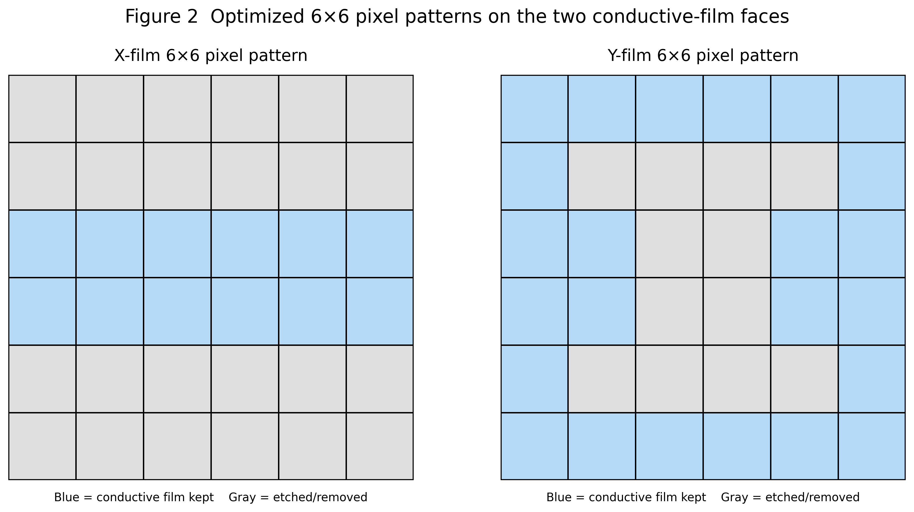

# 02 历史工作流还原
2026-09-30｜静态走读，不执行原代码。来源编号见[核验记录](../../../../事实核验/本科毕设R1_20260930/核验记录.md)，文件导航见[05](05_代码与数据地图.md)。

## 先有结构探索，才有最终自动化

U01与U02共同补出这条阶段链：既定GA＋仿真路线与立体建议→单片手工学习（原件未定位）→十字脚本学习→PET＋薄实体电阻膜→无图案尺寸/材料尝试（本人回忆）→粗像素图案及较好形态观察→Ohmic Sheet继承种子并重搜→更细图案与Y骨架/X局部变化→最终13.20结果→以该结果为参考的1/4镜像尝试。场监视器与出图属于正式结果整理线，具体与每次搜索的先后还需按工程分别确认。这是有部分原件连接的阶段链，不是每一步都已取得时间戳的连续操作录像。

代码保留了由少量几何量到像素图案的多种版本。code01–05的编码有p、w、h；code06–07增加两个宽度；code09进一步拆出两组长度、高度。早期版本还使用GAOSHANG材料，因此不能把这些都称为最终电阻膜实验。它们更适合帮助你回忆当时如何学习“把自由度交给程序”。

后来的条带、工字图案把自由度限制在少量可解释几何量。6×6版本则用3×3种子镜像，两个面各9个独立开关；9×9版本出现5×5种子与固定尺寸、局部尺寸微调分支。最终12×12允许两张较大的mask并混合尺寸与双片阻。这不是一条由文件名就能完全证明的线性谱系：某些分支可能并行、回退或拼接，需要保留未知。

## 图案与材料怎样一步步传到后续版本

| 阶段 | 已有原件怎样连接 | 这一步在研究中意味着什么 |
|---|---|---|
| 十字学习模型 | 联合算法.txt是ResFilm双片、上下开放；code01–05及早期工程是GAOSHANG双片、底部electric | 练习模型有多个变体，不能把材料或背板状态统一倒推 |
| PET与有限材料组合 | 条带/工字代码、40档工程及新产品表 | 把目标材料落实为支撑与功能层；60/80表项可对应，40档仍有差异 |
| 薄实体6×6较好图案 | 数据存档14的best_result、原图和模型历史；X中央完整条带、Y外框窗口 | 从搜索输出中观察到值得保留的形态；“纺锤”是本人形象记忆 |
| 换为Ohmic Sheet | 稳定6×6的FIXED_P/H和两组FIXED_MASK与薄实体结果相同，初始化纳入种子及扰动 | 改变膜表示后沿已有设计继续，避免每轮完全重来；不抹去论文比较的实际mask差异 |
| 9×9阶段 | 沿用6×6 Ohmic获选p/h；5×5种子、中心通道与窗口，围绕种子初始化 | 有形态和参数继承；尚未找到6→9严格自动映射，不能说全部像素按比例复制 |
| 12×12 hybrid | FINAL_9X9种子、9×9镜像与像素中心升采样函数；母本/局部/模板混合 | 较高分辨率打开局部变化空间；有效片阻仍固定60 |
| 高频补偿hf | LOWFREQ双mask等于hybrid保存mask；整张Y固定，X局部变化；连续双Rs开启 | 这时搜索维度明确改变；源码对物理分工的注释是设计意图，未完成因果验证 |
| 最终多模板 | BEST82种子等于hf获选；Y仅保护骨架，其余可动；最终获选mask仍与种子一致 | 最终不是全部Y固定，也不是末段发现新拓扑；尺寸/片阻微调与图案探索并存 |
| 独立quarter分支 | CURRENT_FULL等于最终mask，取左上6×6后双向镜像；保存12.64 GHz | 规整化是新增受限结构族的探索，不能拿其结果证明所有对称结构更差 |

“继承”也分层次：参数数值继承、形态相似、明确像素映射、保存数组逐项一致，并不是同一种证据。上表刻意把6→9的缺口保留，把9→12的实际映射与hf之后的数组对应写实。具体定位见[U02逐项续核](../../../../事实核验/本科毕设R1_20260930/U02_回忆与源文件续核.md)。

下图是历史原图，未重绘。左边X膜保留完整中央条带，右边Y膜有外框和阶梯窗口；这为你的记忆提供了可指认对象。6×6说的是可设计像素，不能与CST求解网格混为一谈。

## 一个最终候选到底包含什么

有效的个体是一个字典，保存p、h、rsx、rsy、mask_x、mask_y和origin。前四项控制周期/膜尺度、高度和两方向片阻；两张mask控制哪块膜面保留电阻层。origin解释候选如何产生，不直接改变电磁模型。最终范围为p=12.85–13.55 mm、h=9.65–10.45 mm、Rs,x=80–240、Rs,y=20–80 Ω/□，数值按既定精度取整。这是离散图案与有限精度连续变量组成的混合空间。

早期“chromosome是一串位”的说法在最终版已不够准确。最终的染色体是包含多种类型的设计记录；GA只是把它当作可以复制、组合、扰动和评分的个体。两张12×12图案也不是288个都随意独立翻转：骨架、密度和连通筛选限制了实际搜索。

## 从候选到一次evaluation，每个箭头发生了什么

~~~mermaid
flowchart TD
 A[候选参数、双片阻、两张mask] --> B[取整修复并生成缓存键]
 B --> C{已评估或不合约束?}
 C -->|缓存命中| H[复用已有评分]
 C -->|不合约束| I[记录原因并给零分]
 C -->|需要求解| D[Python新建CST工程并写History]
 D --> E[运行频域求解器并保存临时工程]
 E --> F[从结果树读取同模复数S参数]
 F --> G[转dB、识别区间、计算fitness]
 G --> H
 H --> J[日志、精英与下一代生成]
 J --> A
~~~

**候选→Python中的合法设计。** repair先去孤立像素、限制密度，并在Y膜保留指定骨架；prefilter再检查保留数量、孤立点和连通分量。缓存键由真正参与建模的变量组成，不含origin，因此同一个结构从两条生成路径出现，可以复用结果。不是每一个evaluation都调用CST：保存的128条记录里有113次实际开始并完成求解、15次缓存命中。

**Python→CST模型。** 最终run_cst_simulation每次新建工程，将具体数值展开成CST History命令，逐项建立单位、背景、材料、PET、图案与边界。它不是打开一个固定工程，仅给CST参数表中的p和h赋值。历史参数表只看到theta和phi；p/h直接出现在坐标文字中。这解释了为什么材料建模命令必须符合当前CST版本：Python负责发送，CST仍要逐条理解这些命令。

**PET→电阻膜几何。** 两块PET沿正交竖直平面放置，底部z=0、顶部z=h。mask的网格单元尺度由p/12和h/12决定，1表示创建电阻片，0表示省略。最终sheet辅助函数先建临时实体、取指定面生成面片，再删除辅助实体。这里临时实体是为了可靠取得几何面，并不表示最终Ohmic Sheet还保留实体厚度。X膜放在PET的+Y面，Y膜放在+X面，几何位置本身也是模型比较需要保持的条件。

**CST模型→solver。** Type模板先给初始边界，后面的ground函数将Zmin改为electric，Zmax保留开放端口侧；XY为周期/单元边界。频域四面体求解器求解每个候选的电磁边值问题。快速搜索明确关闭网格自适应。run_solver是真正开始计算的动作；改了历史命令本身不等于已经得到新响应。

**solver→response。** 求解完成后保存临时工程，读取结果树中的“1D Results / S-Parameters / SZmax(1),Zmax(1)”。它表示从Zmax的第1模式入射，返回Zmax第1模式的复数幅度比。这里没有把所有模式自动加总。Python取绝对值再做20log10，得到保存的rl_dB；导出表有频率、幅度和dB三列，未保留复相位。

**response→fitness。** 评分把物理目标变成GA能比较的一个数。最终extract_metrics先识别阈值下的连续段，取最长段的端点差，再综合低端、高端、反射裕量和若干额外奖励。更宽、更靠近目标窗边界一般更好，但评分并非简单等于带宽，也不是吸收率。最后保存的是最优score对应设计，不应未经检查说成所有候选中的纯带宽最大者。

**fitness→下一候选。** 选择让高分个体更可能成为父代；交叉交换部分图案并组合数值变量；变异扰动尺寸、片阻或局部像素；模板和已知种子定期注入。精英保留减少已找到的好结构丢失。每代16个体，共8代，停止是预算设置，不是数学上证明收敛。

**候选→文件。** 每次记录参数、mask、状态、分数、工程路径；最终把获选工程、mask、摘要和S11图表另存。失败可记录异常并得到零分，所以“低分”未必都是坏电磁性能，也可能是几何筛选或求解失败。研究分析必须区分这些原因。

## 读最终大脚本时最容易误会什么

S02有5480行，包含多轮追加覆盖。相同函数名后面重新定义，会覆盖前面的定义；早定义函数运行时读取的全局变量，也可能已经变成后面的配置。有效的最终配置从约4272行展开，不能只读文件顶部就报告范围、种群大小或评分。

尤其是早期指标N_pass/N_all×16，与最终“最长连续段端点差”不同。跨版本比较时，先确认每个数字的定义；不能把12.895522和12.88仅解释成显示精度变化。最终分支还保留N_pass×平均频率步长这个辅助量；端点跨度与点数所代表区间也不相同。

代码顶部包含创建目录和启动CST环境的动作，所以本轮连“导入看看”也没有做。文本与AST定位已足以恢复调用链。后续最小Demo应重新摘出纯函数进入隔离目录，不能把原脚本当库直接导入。

## 获选设计之后还发生了什么

最终保存参数为p=13.1409 mm、h=10.0731 mm、Rs,x=140.79、Rs,y=35.461 Ω/□。获选X/Y图案与该轮13.12 GHz种子一致，尺寸、片阻变化。日志还显示探索过62种不同图案组合，因此准确说法是“允许图案变化的搜索最后选回原图案并调整参数”，而不是“最后完全没搜图案”或“新图案带来提升”。

同一最终工程的后续历史加入8.8、12、15.5 GHz电场、磁场和功率损耗监视器，并开启自适应网格。日志记录晚间3轮自适应。你确认这是师兄要求正式做结果后的操作阶段，初期场图由你手动导出。现有场图、论文和脚本能支持这一工作链；是否后来实现自动场图导出，尚未在已查文件中找到。

不能把这次后期求解直接当作GA导出的那条S11：两者设置不同，且尚缺逐点对应。这个缺口正好提示后续应先问“我展示的曲线是哪次求解的”，再讨论它有多精确。

**当年可能处于工具使用层：** 能改脚本让一轮计算结束、看到分数上涨，却未必区分参数写入、场求解、插值输出与指标定义。

**现在建议补到的理解层：** 面对任意一个候选，能从它的变量说到模型命令、出射通道、评分与日志，并解释每一步可能失败在哪里。

## 对称化尝试还有一条日志边界

独立quarter分支的保存结果为4.56–17.20 GHz、12.64 GHz；它继承最终图案左上角，但还改变尺寸/片阻并允许quarter继续演化，不是只改一个对称开关。当前ga_log只剩表头，另有generation=0,index=1的连接中断。源码确有启动清日志逻辑，但“后来重启覆盖了旧日志”仍是推断，不能据此编出完整执行过程。可以讲已做过并保存了这类尝试，不能讲已经核实全部代数完成。接近结题所以不采用，来源是U02本人回忆。
