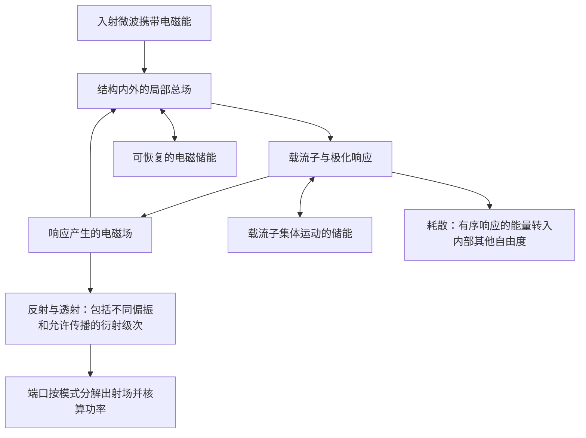

# 10｜Block 1：能量到底去了哪里——逻辑链与物理图像

2026-10-03｜INTERNAL｜教学总结，供本人复习及 Chat 审阅

这份总结把本节已经讨论的内容按物理依赖重新组织。它是当前教学解释，不是本科时期的理解证明；实际答题程度见[09 教学进度](09_教学进度与本人复述记录.md)，历史事实见[R1 核验记录](../../../../事实核验/本科毕设R1_20260930/核验记录.md)。未运行 CST/GA，未启动 R2/R3。

## 1. 先看整个过程：场与材料共同决定能量去向

微波本身是传播的电磁场，携带能量。入射场到达结构后，驱动载流子和极化响应；这些响应也产生电磁场，与入射场共同构成局部总场。总场又决定材料响应。最终的反射、透射、局部场和电流必须同时满足 Maxwell 方程、边界条件与材料关系。

因此，下图的箭头是解释各物理量的联系，不是说微波先通过一扇“匹配门”、再单向走到电阻中。匹配、局部场和耗散是同一个散射问题的不同方面。

本项目在底部设置理想 PEC，排除穿过底部的透射；上方仍需核对全部相关反射模式。真实局部场由图案、片阻、PET 支撑、结构高度、周期和背板共同决定。

## 2. 载流子受力为什么会传递能量，却不一定立刻发热

电场对电荷施力，力与运动同向时向粒子供能，反向时粒子向场返还能量。很多载流子的平均定向运动形成传导电流。即使电子带负电，传统电流方向也已把这个符号包含进去。

单个粒子的瞬时电场受功功率，以及单一载流子种类的宏观功率密度为：

$$
\begin{gathered}
P_q=q\mathbf E\cdot\mathbf v \\
\mathbf J=nq\mathbf v_d \\
p_{\mathrm{field\to carriers}}=nq\mathbf E\cdot\mathbf v_d=\mathbf E\cdot\mathbf J.
\end{gathered}
$$

这里，$P_q$ 是单粒子功率（W），$q$ 是带正负号的电荷量（C），$\mathbf E$ 是局部总电场（V/m），$\mathbf v$ 是该粒子瞬时速度（m/s），$n$ 是数密度（m⁻³），$\mathbf v_d$ 是平均漂移速度（m/s），$\mathbf J$ 是传导电流密度（A/m²），$p_{\mathrm{field\to carriers}}$ 是单位体积场向载流子做功率（W/m³）。平均漂移速度指对大量载流子平均，不是对整个周期平均。多种载流子应分别计算后求和。

电场做功可以暂时增加集体漂移动能，也可以通过耗散转入其他自由度。电子与晶格等自由度交换能量后，能量逐渐分散、热化。不是每次散射都同样向晶格转能；动量弛豫时间也不必等于电子向晶格传能的时间。相干振动与定向漂移不能直接等同于升温。

严格区分：内能是系统的状态量；温度描述热平衡或适当局部平衡下的热状态；热是因温差而传递的能量。通常说“焦耳发热”是指电功经耗散增加内能，不是说材料储存着一种叫“热”的物质。材料是否升温还取决于散热和内部能量分配，不能仅凭某处场与电流点乘的符号判断。

## 3. 即时欧姆与 Drude：把交换、储能和耗散分开

即时、各向同性欧姆模型取正实数电导率：

$$
\begin{gathered}
\mathbf J=\sigma\mathbf E \\
p_{\mathrm{diss}}=\mathbf E\cdot\mathbf J=\sigma|\mathbf E|^2\geq0.
\end{gathered}
$$

$\mathbf J$ 是传导电流密度（A/m²），$\mathbf E$ 是局部总电场（V/m），$\sigma$ 是电导率（S/m），$p_{\mathrm{diss}}$ 是瞬时耗散功率密度（W/m³）。电场和电流同步反向，点乘仍非负。这个近似没有单独保留漂移动能的惯性演化，不意味着整个电磁结构没有储能。

保留惯性的简单 Drude 模型为：

$$
m\frac{\mathrm d\mathbf v_d}{\mathrm dt}=q\mathbf E-\frac{m\mathbf v_d}{\tau}.
$$

$m$ 是载流子的模型有效质量（kg），$\mathbf v_d$ 是平均漂移速度（m/s），$t$ 是时间（s），$q$ 是带符号电荷量（C），$\mathbf E$ 是局部总电场（V/m），$\tau$ 是动量弛豫时间（s）。在单频响应且 $\omega\tau\ll1$ 时可以近似即时跟随；$\omega$ 是角频率（rad/s），$\omega\tau$ 是无量纲量。突然开关场的瞬态不能仅凭原单频条件处理。

它的能量关系可写为：

$$
\mathbf E\cdot\mathbf J
=\frac{\mathrm d}{\mathrm dt}\left(\frac{\tau |\mathbf J|^2}{2\sigma_0}\right)
+\frac{|\mathbf J|^2}{\sigma_0}.
$$

$\mathbf E$ 是局部电场（V/m），$\mathbf J$ 是传导电流密度（A/m²），$t$ 是时间（s），$\tau$ 是弛豫时间（s），$\sigma_0$ 是正的直流电导率（S/m）。括号内是漂移动能密度（J/m³）；其导数和最后的阻尼耗散项均为 W/m³。这里假定模型参数不随时间改变，且漂移能与其他储能分开计数。

这给出三幅图像：建立响应时，电场做功可以同时储能和耗散；某瞬间场与电流点乘为负时，漂移动能可以同时供应能量返还和非负耗散；总局部电场真的撤为零时，场不再做功，残余漂移动能仍可继续耗散。撤去外部驱动不自动等于总局部场为零，因为可能还有自场。

在总局部场为零、参数不变的简化情况下：

$$
J(t)=J_0e^{-t/\tau}.
$$

$J(t)$ 是选定方向的电流密度分量（A/m²），$J_0$ 是撤场瞬间该分量（A/m²），$t$ 是撤场后的时间（s），$\tau$ 是弛豫时间（s），$e$ 是自然常数。一个弛豫时间后降到初值的约 36.8%，不是精确归零。本人已独立算出这个指数解。

## 4. 从局部做功到整个结构的能量账

电磁能流由 Poynting 矢量描述：

$$
\mathbf S=\mathbf E\times\mathbf H.
$$

$\mathbf S$ 是电磁功率流密度（W/m²），$\mathbf E$ 是总电场（V/m），$\mathbf H$ 是总磁场强度（A/m），叉乘给出能流方向。它与后文散射矩阵的字母 S 不是同一个量。

在本节采用的储能与耗散模型中，选固定体积、忽略额外机械输运等项，有：

$$
P_{\mathrm{in}}-P_{\mathrm{out}}
=\frac{\mathrm dU_{\mathrm{stored}}}{\mathrm dt}+P_{\mathrm{diss}}.
$$

$P_{\mathrm{in}}$、$P_{\mathrm{out}}$ 分别是穿过边界流入、流出的电磁功率（W）；$U_{\mathrm{stored}}$ 是模型中一致定义、避免重复计数的可恢复储能（J），可包含场能与载流子漂移动能；$t$ 是时间（s）；$P_{\mathrm{diss}}$ 是转入材料其他内部自由度的耗散功率（W）。耗散不是另一束穿过边界的电磁波；耗散后的热传导输出需另做热学记账。色散介质的储能不能无条件照搬简单无色散介质公式。

稳定周期响应意味着每周期储能回到原值，不意味着每一瞬间储能变化率为零。完整周期平均后：

$$
\begin{gathered}
\langle P_{\mathrm{in}}\rangle
=\langle P_{\mathrm{out}}\rangle+\langle P_{\mathrm{diss}}\rangle \\
\langle P\rangle=\frac1T\int_{t_0}^{t_0+T}P(t)\,\mathrm dt.
\end{gathered}
$$

$P_{\mathrm{in}}$、$P_{\mathrm{out}}$、$P_{\mathrm{diss}}$ 仍分别为输入、输出和耗散功率（W）；尖括号表示周期平均，$P(t)$ 是被平均的功率（W），$T$ 是周期（s），$t_0$ 是积分起点（s），$t$ 是时间（s）。只积分得到能量，除以周期才得到平均功率。

所以，局部场强或储能很大不单独证明吸收强。要看每周期实际耗散多少入射能量。无损结构可以暂存并返还能量；完全无损、有 PEC 背板且没有其他出口的稳定结构，必须把入射功率全部反射回去。

## 5. 匹配、损耗、片阻为什么必须一起考虑

阻抗匹配描述整个结构如何与入射波的电场、磁场比例相容，从而减少反射；材料损耗描述能量怎样不可逆地转入内能。无损、无背板且无其他通道的结构，即使零反射，也可以是全部透射。匹配与耗散不可互相替代。

固定入射微波，不等于固定材料内部总电场。电导率或片阻改变后，电流、响应场、反射和局部总场都会自洽改变。因此不能只盯住耗散式中的材料参数。足够厚的良导体通常强反射；理想 PEC 可以有表面电流，但切向电场为零、无欧姆损耗。本项目的 PEC 是理想边界，PET 是真实支撑聚合物，两者不同。

对厚度方向电流近似均匀、无显著附加电抗的均匀欧姆薄膜：

$$
\begin{gathered}
R_s=\frac{\rho}{t_f}=\frac1{\sigma t_f} \\
R=R_s\frac{L}{w}.
\end{gathered}
$$

$R_s$ 是片阻（Ω/□），$\rho$ 是导电膜电阻率（Ω·m），$t_f$ 是导电膜厚度（m），$\sigma$ 是电导率（S/m）；$R$ 是长方形膜两端电阻（Ω），$L$ 是沿电流方向长度（m），$w$ 是横向宽度（m）。两端电极覆盖完整相对边缘，忽略接触电阻、边缘效应。正方形的长度与宽度抵消，所以“每方”不是“每平方米”。本项目 PET 厚度不能代替导电膜厚度。

对纯电阻、各向同性的零厚度 sheet：

$$
\begin{gathered}
\mathbf E_t=R_s\mathbf K \\
q_s=\mathbf E_t\cdot\mathbf K=R_s|\mathbf K|^2=\frac{|\mathbf E_t|^2}{R_s}.
\end{gathered}
$$

$\mathbf E_t$ 是膜面总切向电场（V/m），$R_s$ 是正实数片阻（Ω/□），$\mathbf K$ 是表面电流密度（A/m），$q_s$ 是单位面积瞬时耗散功率（W/m²）。局部片阻不因电流沿水平或对角线而改变；几何与电极改变的是整体电阻及电流分布。真实各向异性膜须用更一般的本构关系。

固定电流时增大片阻增加耗散，固定电场时却相反；实际散射中二者都不预先固定。开路与零电阻理想极限都不是良好耗散体，但这不证明任意结构存在同一个最佳有限片阻。本项目的两组实数片阻是材料模型参数，不是整个结构的输入阻抗，也不证明真实商品膜在全频段都可如此描述。

## 6. 端口与 S 参数：把出口分成可核算的模式

端口是描述场输入输出的参考截面。模式是该截面及其相邻传播区域允许的成对电场、磁场分布；同一传播方向可以有两个独立偏振。端口模式不自动等于结构内部共振模式。

对单一模式入射、使用适当功率归一化的传播模式：

$$
\begin{gathered}
b_i=S_{ij}a_j \\
P_j^{\mathrm{in}}=|a_j|^2 \\
P_i^{\mathrm{out}}=|b_i|^2.
\end{gathered}
$$

$a_j$ 是第 j 个入射模式的复振幅（√W），$b_i$ 是第 i 个出射模式的复振幅（√W），$S_{ij}$ 是无量纲散射系数，第一个下标标出射模式、第二个标入射模式；$P_j^{\mathrm{in}}$、$P_i^{\mathrm{out}}$ 是对应模式功率（W）。复振幅同时包含幅度和相位。此时相应功率比是散射系数的模平方；多个入射模式同时激励时，还需考虑其相干叠加。

如果只是随意选定基底并读取展开系数，则单位系数对应的模式功率可能不同。对功率正交的传播模式：

$$
P_{\mathrm{out}}=\sum_i |c_i|^2 P_i^{(0)}.
$$

$P_{\mathrm{out}}$ 是总输出功率（W），$c_i$ 是任意基底下第 i 个模式的无量纲系数，$P_i^{(0)}$ 是该基底单位系数对应的功率（W），求和遍历相关出射传播模式。基底电磁场同时放大两倍、系数缩小一半，不改变真实场和功率；不能因此省略不同基底的功率权重。归一化也不是把所有输出除以其总和强行凑成 100%。非功率正交基底则还需计交叉项。

本项目读取 `SZmax(1), Zmax(1)`，直接对应指定模式返回自身的复响应，不自动包含另一个偏振。实际模式与偏振方向的对应、所导出系数的归一化仍待核。保存表未保留相位，不能由幅度曲线单独重建完整复响应。

## 7. 为什么周期结构出现 Floquet 通道

正入射照射理想无限周期阵列时，相邻等价单元受到相同相位的驱动。不同观察方向产生不同传播路径差；相邻单元间距限制了路径差上限。远处某些方向使所有单元的贡献重新同相，形成允许的衍射方向。斜入射时还须加上相邻单元入射相位差。

这种几何干涉是 Floquet 展开的直观入口；更完整的理论是周期平移对称性使场具有 Bloch 相位，去掉该相位后的周期部分可展开为空间 Fourier 级次。Floquet port 正是在均匀端口区域用这些空间级次及偏振分解场。正式相位条件推导仍留后续模块，不能把本节几何判断记成已完成完整推导。

正入射、沿一个晶格方向考察、上方为均匀空气时：

$$
\begin{gathered}
|\Delta\ell|\leq p \\
\Delta\ell\simeq p\sin\theta \\
p\sin\theta=m\lambda.
\end{gathered}
$$

$\Delta\ell$ 是相邻单元到同一观察点的有符号路程差（m）；$p$ 是该方向周期（m）；$\theta$ 是与表面法线的夹角；$m$ 是整数衍射级次，无量纲；$\lambda$ 是空气波长（m）。第一式是任意观察距离下的几何上限；第二式是远处近似；第三式给出对应远场级次的相位条件。二维阵列还需同时满足两个周期方向的条件。

当波长大于周期，第一非零级次不能传播；相等时仅达到沿表面掠射的临界点，没有法向出射功率；波长小于周期后才允许向上方传播。允许传播不保证实际激发功率大。不能传播的空间级次仍可构成沿离面方向衰减的倏逝近场，影响耦合和局部场，不能从场计算中概念性删除。

本项目空气正入射、周期约 13.14 mm，第一非零级次临界频率约 22.8 GHz，高于 2–18 GHz；应优先核对零级两偏振。参数改变、斜入射、外媒质改变或有限阵列，都需要重新判断。

路径差可视化：[离线交互图](教学可视化/路径差/output/index.html)、[静态图](教学可视化/路径差/output/figure.png)、[假设与验证说明](教学可视化/路径差/README.md)。GitHub 可查看静态图；交互 HTML 下载后用浏览器打开。

## 8. 回到 13.20 GHz：观测量与结论之间还差什么

对稳定周期、被动结构，在所有出射功率正确核算的前提下：

$$
A=1-R_{\mathrm{tot}}-T_{\mathrm{tot}}.
$$

$A$ 是总吸收率，$R_{\mathrm{tot}}$ 是全部反射功率占入射功率的比例，$T_{\mathrm{tot}}$ 是全部透射功率占入射功率的比例，三者无量纲。若存在其他能量出口，也必须纳入。理想 PEC 背板使透射项为零；不能因此把总反射替换成单个同模反射。

曲线分贝约定为：

$$
s_{\mathrm{dB}}=20\log_{10}|S_{\mathrm{same}}|.
$$

$s_{\mathrm{dB}}$ 是指定同模反射的分贝值（dB），$S_{\mathrm{same}}$ 是无量纲同模复系数，竖线表示复数模，$\log_{10}$ 是十进制对数。−10 dB 对应振幅约 0.316；只有适当功率归一化时，其模平方才对应 10% 的入射功率。单一通道减少的功率还可能进入其他出射通道；其他通道可忽略或受控时，同模低反射才更能提示耗散增加。

已有结果的准确结论：在 2–18 GHz 保存扫描中，同模反射不高于 −10 dB 的最长连续采样段为 4.80–18.00 GHz，端点跨度为 13.20 GHz。保存步长 0.08 GHz；18 GHz 是扫描终点，不是已找到的物理截止。82.5% 是相对于扫描窗口的频带覆盖比例，不是平均吸收率。

还缺：实际端口模式定义和功率归一化、正交偏振及所有相关传播出口的功率、与耗散积分的交叉核对，以及独立的数值收敛与更密频率检查。已有后期自适应记录不自动证明保存曲线的这些条件全部成立。

## 9. 用三句话把本节接起来

1. 入射电磁波驱动材料响应，响应又改变总场；整个结构的匹配决定反射表现，局部场与电流决定耗散。
2. 场和载流子可以暂存、返还能量；稳定周期下净储能不再累积，输入功率最终由全部出射功率与耗散分担。
3. CST 端口与 S 参数负责按模式观察出口；只有出口核算完整、归一化和数值可靠性成立，才能把低反射升级为总吸收结论。

这三句话是复习主线，不是替代本人答题的掌握证明。本次巩固后仍停在第一 block，不自动进入下一节。
