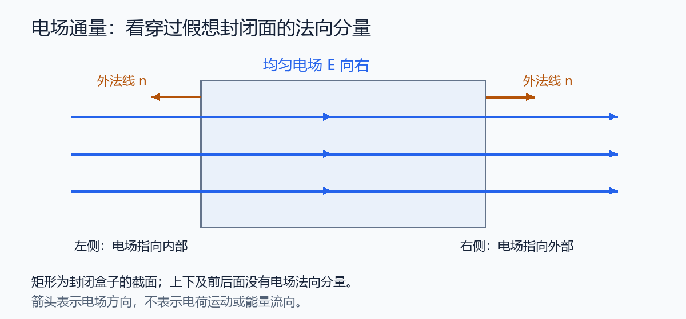
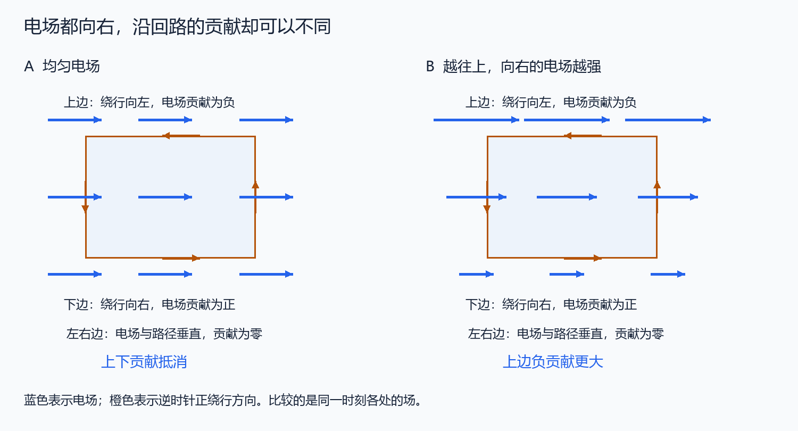
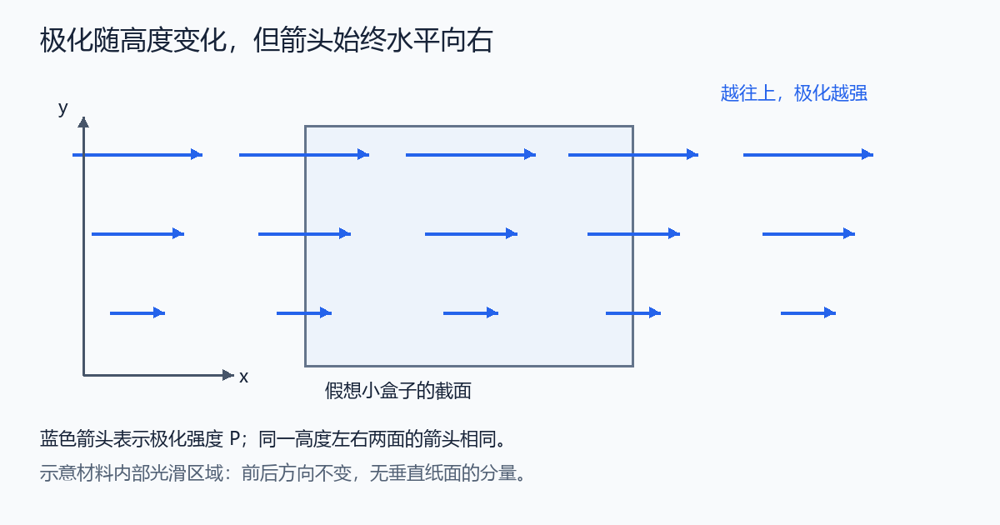
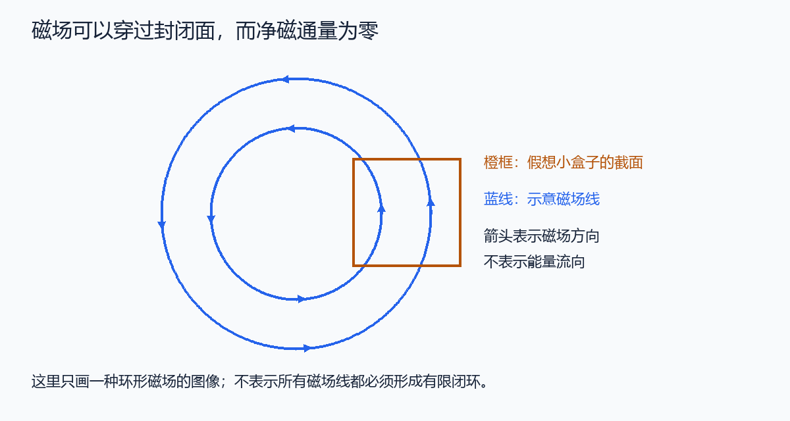
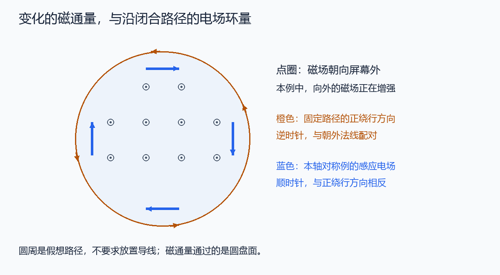
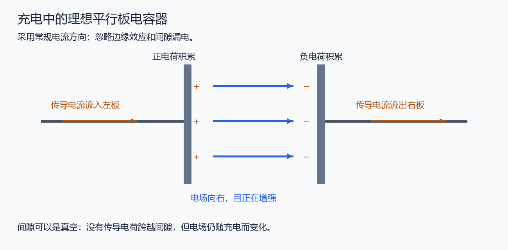
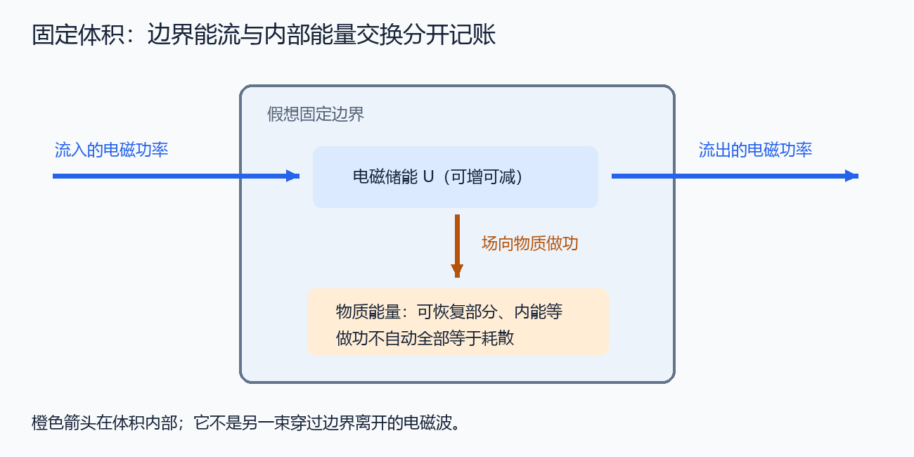
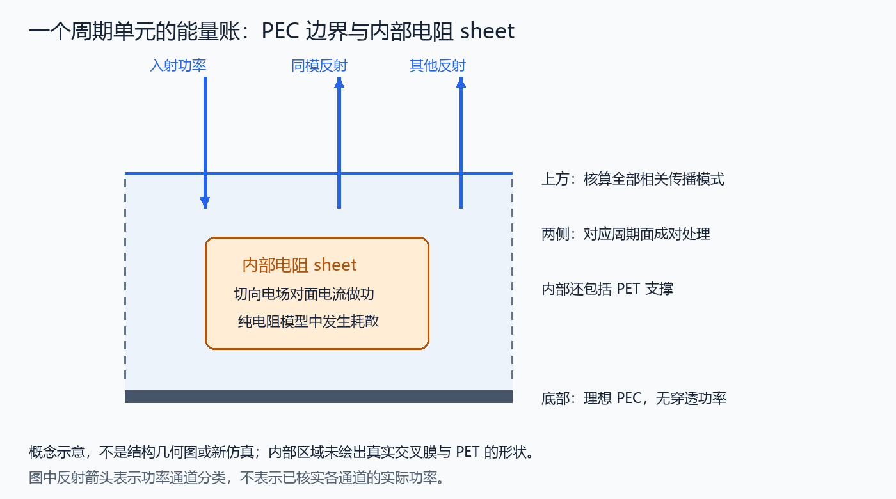

# 12｜Block 2：Maxwell 如何连接场的变化与能量账

2026-10-03—2026-10-04｜INTERNAL｜当前教学解释，不是本科历史能力证明

实际作答、提示程度与纠偏见[09 教学记录](09_教学进度与本人复述记录.md)。本文是教师整理，不能整体视为本人已独立复述或推导。历史项目事实继续以[R1](../../../../事实核验/本科毕设R1_20260930/核验记录.md)、[U02](../../../../事实核验/本科毕设R1_20260930/U02_回忆与源文件续核.md)、[U03](../../../../事实核验/本科毕设R1_20260930/U03_制造判断与片阻时间线.md)为准。未运行 CST、GA 或历史科研脚本，未启动 R2/R3，未制作 PPT。

## 1. 为什么不能只记“输入等于输出加损耗”

场建立时可以暂存能量；场对载流子的做功也可能改变漂移动能，而非全部立刻耗散。需要由场方程明确：哪里是储能变化、哪里是穿过边界的电磁功率、哪里是向物质做功。稳定周期的简化必须在完整关系之后作出。

## 2. 通量、散度、环量与旋度各描述什么

电场本身决定单位正电荷的局部电场受力。通量是场法向分量对面积的有符号积分；散度是小封闭面的净向外通量除以体积、缩小到一点的极限。净通量为零不代表处处没有场。体积内净电荷为零，也不等于每一点净电荷体密度为零。

电场环量是沿闭合路径累计切向电场作用，单位 V，也就是 J/C。时变场的环量使用同一时刻整条固定路径的场，不等于追踪真实粒子用有限时间绕一圈所得到的实际功。旋度的法向分量是小平面回路的单位面积环量极限；它描述邻近位置间的关系，不是该点电场强弱或载流子转圈速度。

场箭头都向右，但上方更强时，逆时针矩形回路的上下边贡献不抵消，环量可为负。旋度不要求场线画成圆圈。一个矢量的大小非负，但确定坐标系后，分量是可取负值的标量；“分量为负”与“散度为负”不是一回事。

Stokes 定理把面内局部环量与外边界环量连接：相邻小面公共边的贡献抵消，只留下外边界。它是数学关系；法拉第定律把电场旋度与磁场时间变化联系起来，是物理规律。旋度没有取代电场或电势；一般时变电场不能仅靠一个单值标量电势的空间变化完整描述，旋度本身也不能确定完整电场。

## 3. 宏观场、极化与四条 Maxwell 方程

本文公式均采用 SI 制和瞬时实场，不使用复振幅。以下符号在本节沿用：

| 符号 | 含义、类型与单位 |
|---|---|
| $\mathbf E$、$\mathbf B$ | 电场、磁感应强度；局部矢量；V/m、T |
| $\mathbf D$、$\mathbf H$ | 电位移、磁场强度；宏观局部矢量；C/m²、A/m |
| $\mathbf P$ | 极化强度，即单位体积电偶极矩；矢量；C/m²，不是功率 |
| $\rho_{\mathrm f}$、$\rho_{\mathrm b}$ | 自由、束缚净电荷体密度；标量；C/m³ |
| $\mathbf J_{\mathrm f}$ | 自由电流密度；矢量；A/m²；当前主要讨论固定材料内的传导响应 |
| $\varepsilon_0$、$\mu_0$ | 真空介电常数、磁导率；标量；F/m、H/m |
| $t$ | 时间；标量；s；偏导数取固定空间位置 |

自由/束缚是宏观模型的分账方式，不等于完全无约束/绝对不移动。电中性材料也可以极化。在光滑的材料内部：

$$
\mathbf D=\varepsilon_0\mathbf E+\mathbf P,
\qquad
\rho_{\mathrm b}=-\nabla\cdot\mathbf P.
$$

第一式各项为矢量，单位 C/m²；第二式各项为标量，单位 C/m³。界面束缚面电荷需另外处理。空间不均匀的极化不一定有非零散度；例如水平极化仅随高度改变时，左右面的法向贡献仍可相抵。

教学中先用无磁化模型 $\mathbf B=\mu_0\mathbf H$ 区分两个磁场量；一般磁化材料需要加入磁化响应，不能无条件沿用这条关系。下述四式使用标准宏观自由电荷/自由电流记账：

$$
\begin{aligned}
\nabla\cdot\mathbf D&=\rho_{\mathrm f},
&\nabla\cdot\mathbf B&=0,\\
\nabla\times\mathbf E&=-\frac{\partial\mathbf B}{\partial t},
&\nabla\times\mathbf H&=\mathbf J_{\mathrm f}+\frac{\partial\mathbf D}{\partial t}.
\end{aligned}
$$

四式依次描述自由电荷与电位移净通量、无磁单极子条件、磁场时间变化与电场局部环量、自由电流及电位移变化与磁场强度局部环量。两条散度方程单位分别为 C/m³、T/m；两条旋度方程单位分别为 V/m²（等于 T/s）、A/m²。

对应积分形式列在下面供复习。**这是教师整理；尤其安培–Maxwell 积分形式本轮未由本人单独推导或解释，不能据此登记为全部积分/微分形式独立达标。**

$$
\begin{aligned}
\oint_{\partial V}\mathbf D\cdot\hat{\mathbf n}\,\mathrm dA
&=Q_{\mathrm f,V},\\
\oint_{\partial V}\mathbf B\cdot\hat{\mathbf n}\,\mathrm dA
&=0,\\
\oint_{\mathcal C}\mathbf E\cdot\mathrm d\boldsymbol\ell
&=-\frac{\mathrm d}{\mathrm dt}\int_\Sigma\mathbf B\cdot\hat{\mathbf n}\,\mathrm dA,\\
\oint_{\mathcal C}\mathbf H\cdot\mathrm d\boldsymbol\ell
&=\int_\Sigma\left(\mathbf J_{\mathrm f}+\frac{\partial\mathbf D}{\partial t}\right)
\cdot\hat{\mathbf n}\,\mathrm dA.
\end{aligned}
$$

$V$ 是固定体积、$\partial V$ 是封闭外边界；$Q_{\mathrm f,V}$ 是体积内自由电荷总量（C）。$\Sigma$ 是固定可定向曲面，$\mathcal C$ 是其边缘，$\hat{\mathbf n}$ 是无量纲单位法线，$\mathrm dA$ 为面积元（m²），$\mathrm d\boldsymbol\ell$ 为沿路径的位移矢量（m）；曲面法线与边缘绕行按右手规则配对。四个积分等式为标量，单位依次是 C、Wb、V、A。微分形式在光滑区域使用；积分形式配合相应面电荷/面电流可处理界面。

磁场散度为零不等于任意开放截面的磁通量为零；磁场不随时间变化只直接限制电场旋度，不要求电场为零。由零旋度推闭合路径零环量时，需有处于该光滑区域内、以该路径为边缘的曲面，不跨越被排除的奇异/时变区域。

## 4. 位移电流与电荷守恒

位移电流密度 $\partial\mathbf D/\partial t$ 的单位是 A/m²，不必代表电荷跨越某位置。真空中它来自电场变化；物质中还包含极化变化。无载流子真空中可以有该项，却没有传导焦耳耗散。“没有导线”单独并不能证明没有载流子。

自由电荷连续性方程为：

$$
\frac{\partial\rho_{\mathrm f}}{\partial t}+\nabla\cdot\mathbf J_{\mathrm f}=0.
$$

两项均为瞬时标量，单位 A/m³；流出多于流入时，内部电荷减少。安培–Maxwell 方程取散度，利用旋度的散度为零和电位移高斯定律，得到同一关系。若无条件删去位移电流项，将强制自由电流散度为零，不允许局部自由电荷积累，不能完整描述充电过程。这是守恒一致性核对，不是仅由电荷守恒独立推出完整电磁理论。

## 5. 核心推导：空间变化项怎样成为能流项

假设静止、局部、线性、各向同性、无色散介质，$\varepsilon$、$\mu$ 为正实且不随时间变化的参数（F/m、H/m）；传导电流单独列账。先在光滑体区域推导，sheet 稍后另加表面项。本人手写原图见[教学附件](教学附件/Block2_20261003_20261004/README.md)。

本人独立选择用电场点乘安培–Maxwell 方程并写出：

$$
\mathbf E\cdot(\nabla\times\mathbf H)
=\mathbf E\cdot\mathbf J_{\mathrm f}
+\mathbf E\cdot\frac{\partial\mathbf D}{\partial t}.
$$

教师给出法拉第方程点乘磁场强度的步骤及以下恒等式；本人随后独立代入、合并，三个负号正确：

$$
\begin{aligned}
\nabla\cdot(\mathbf E\times\mathbf H)
&=\mathbf H\cdot(\nabla\times\mathbf E)-\mathbf E\cdot(\nabla\times\mathbf H)\\
&=-\mathbf H\cdot\frac{\partial\mathbf B}{\partial t}
-\mathbf E\cdot\mathbf J_{\mathrm f}
-\mathbf E\cdot\frac{\partial\mathbf D}{\partial t}.
\end{aligned}
$$

上述等式均为瞬时标量，单位 W/m³；$\mathbf E\times\mathbf H$ 是矢量，单位 W/m²。用恒等式是为了把旋度项组合为可转化成边界净通量的散度，不以背诵恒等式为考核目标。

教师随后演示，利用 $\mathbf D=\varepsilon\mathbf E$、$\mathbf B=\mu\mathbf H$，有：

$$
\begin{aligned}
\mathbf E\cdot\frac{\partial\mathbf D}{\partial t}
&=\frac{\partial}{\partial t}\left(\frac{\varepsilon|\mathbf E|^2}{2}\right),\\
\mathbf H\cdot\frac{\partial\mathbf B}{\partial t}
&=\frac{\partial}{\partial t}\left(\frac{\mu|\mathbf H|^2}{2}\right).
\end{aligned}
$$

括号内为标量能量密度（J/m³），时间导数为标量功率密度（W/m³）；竖线是实矢量大小。参数随时间变化或介质有色散时，不能直接套用这一步。

定义瞬时宏观可恢复电磁储能密度 $u$（标量，J/m³）与 Poynting 矢量 $\mathbf S$（W/m²）：

$$
u=\frac{\varepsilon|\mathbf E|^2+\mu|\mathbf H|^2}{2},
\qquad \mathbf S=\mathbf E\times\mathbf H,
\qquad
\frac{\partial u}{\partial t}+\nabla\cdot\mathbf S=-\mathbf E\cdot\mathbf J_{\mathrm f}.
$$

最后一式各项均为 W/m³。散度是单位体积净向外电磁功率，不是能流随时间变化；$\mathbf E\cdot\mathbf J_{\mathrm f}$ 是场向自由电流做功率密度，未自动等同不可逆耗散。这里的 $\mathbf S$ 不是散射矩阵。$u$ 包含该简单本构代表的可逆材料响应，不包含全部物质内能，不能重复计算同一份储能。

本人的证据是“在给定恒等式后独立完成关键合并”，不是已经无提示重建全部 Maxwell–Poynting 推导。储能转换由教师演示，局部式口述中的密度/总量与方向表述仍需复查。

## 6. 做功、漂移储能与耗散

在参数不变、忽略额外机械输运的简单 Drude 模型中：

$$
\mathbf E\cdot\mathbf J
=\frac{\partial u_{\mathrm d}}{\partial t}+p_{\mathrm{diss}}.
$$

这里 $\mathbf J$ 为传导电流密度（A/m²），$u_{\mathrm d}$ 是漂移动能密度（标量，J/m³），$p_{\mathrm{diss}}$ 是非负瞬时阻尼耗散密度（标量，W/m³）。这份漂移能若由显式电流模型描述，不重复计入上一节简单背景介质的 $u$。做功为负时，漂移能可以同时供应向场返还能量与耗散。总局部电场为零而电流未消失时，电场不做功，但残余漂移动能仍可耗散。本人在纠偏后的独立小检查中答出了后一个情形。

瞬时耗散可以定义，不是只有周期平均才谈焦耳热。正实即时电导模型中，$\mathbf J=\sigma\mathbf E$，故 $\mathbf E\cdot\mathbf J=\sigma|\mathbf E|^2\geq0$；$\sigma$ 是标量电导率（S/m），功率密度单位 W/m³。即时近似忽略显著惯性/记忆，不是“载流子不与电场同向的时间被删除”；电子漂移方向与传统电流方向还须分开。

## 7. 固定体积、周期平均与项目账

对固定体积积分、应用散度定理：

$$
\frac{\mathrm dU_{\mathrm{em}}}{\mathrm dt}
+\oint_{\partial V}\mathbf S\cdot\hat{\mathbf n}\,\mathrm dA
=-P_{\mathrm{work}},
\qquad
P_{\mathrm{in}}-P_{\mathrm{out}}
=\frac{\mathrm dU_{\mathrm{em}}}{\mathrm dt}+P_{\mathrm{work}}.
$$

$U_{\mathrm{em}}$ 是 $u$ 的体积分（标量总能量，J）；$P_{\mathrm{work}}$ 是场对物质做功总功率（W），在光滑体内为 $\mathbf E\cdot\mathbf J_{\mathrm f}$ 的体积分；含 sheet 时另加表面项。$P_{\mathrm{in/out}}$ 表示边界流入/流出电磁功率（W），其差为净流入；表面积分采用外法线，是净向外功率（W）。耗散不作为另一束穿出边界的电磁波；耗散后的热传导需另作热学账。

稳定周期仅要求储能一周期后回到原值：

$$
\left\langle\frac{\mathrm dU_{\mathrm{em}}}{\mathrm dt}\right\rangle
=\frac{U_{\mathrm{em}}(t_0+T)-U_{\mathrm{em}}(t_0)}{T}=0,
\qquad
\langle P_{\mathrm{in}}\rangle-\langle P_{\mathrm{out}}\rangle=\langle P_{\mathrm{work}}\rangle.
$$

$T$ 为周期（s），$t_0$ 为起点时间（s），尖括号表示完整周期积分后除以周期；各项单位 W。平均为零不要求瞬时储能变化率为零。只有相应材料可恢复储能也无周期净积累、没有其他能量转移通道时，才能将平均做功对应到平均耗散；即时欧姆模型则直接对应。

理想 PEC 的切向电场为零，因此 $\hat{\mathbf n}\cdot\mathbf S=(\hat{\mathbf n}\times\mathbf E)\cdot\mathbf H=0$（标量法向能流密度，W/m²），排除穿过底部的透射；PEC 可以有非零面电流，不得说因为没有电流才无耗散。PET 是内部支撑材料，不是 PEC。

纯电阻、局部、各向同性 sheet 满足：

$$
\mathbf E_t=R_s\mathbf K,
\qquad q_s=\mathbf E_t\cdot\mathbf K=R_s|\mathbf K|^2\geq0,
\qquad P_{\mathrm{sheet}}=\int_{\Sigma_s}q_s\,\mathrm dA.
$$

$\mathbf E_t$ 为瞬时总切向电场（V/m），$\mathbf K$ 为面电流密度矢量（A/m），$R_s$ 是正实标量片阻（Ω/□），$q_s$ 为瞬时表面耗散密度（标量，W/m²），$\Sigma_s$ 为 sheet 所在面，$P_{\mathrm{sheet}}$ 为耗散总功率（W）。零厚度不代表零做功；实际材料的频散/表面储能不能被该理想模型自动证明不存在。PET 若在实际设置中有损，也要计入相应体损耗。

端口总场的周期平均 Poynting 法向积分首先给出净功率；区分入射与各出射功率还需模式分解与正确功率归一化。周期侧面净贡献成对抵消，不要求各侧面分别无能流。PEC 下若相关出口核算完整、稳定周期且无其他能量转移通道，吸收率为 $A=1-\sum_mR_m$；$A$ 与各传播反射模式功率比 $R_m$ 都是无量纲周期平均功率比，$m$ 是模式编号。

教学假设中的入射1 W、同模反射0.06 W、正交反射0.17 W，给出0.77 W平均耗散与77%吸收，本人独立算对。这些是假设数，不是新CST结果。空气正入射、原周期约13.14 mm、2–18 GHz时仍优先核对零级两偏振，完整功率账不由单条同模曲线自动补齐。

## 8. 指标边界与后续暂停点

现行严谨表述：在2–18 GHz保存扫描中，指定同模反射量不高于−10 dB的最长连续采样段为4.80–18.00 GHz，端点跨度13.20 GHz，保存间隔0.08 GHz。18 GHz是扫描终点，不是已经确认的高频阈值交点。只有适当功率归一化时，−10 dB才对应该反射通道功率不高于入射功率的10%；82.5%是扫描窗口端点跨度覆盖比例，不是平均吸收率。

本人的最终口述仍是“有13.20 GHz带宽里同模反射不高于10%”，虽能主动说扫描窗口和遗漏偏振，却未独立带全归一化、采样、端点与上限限定。不能把教师多次提供的完整表述计为本人通过。两个相邻保存点合格，不保证其间每个频率都合格；这条逻辑需要与功率归一化分开复查。

仍UNKNOWN：实际模式与偏振对应、实际功率归一化、全通道功率与损耗积分的闭合、GA保存曲线与后期自适应曲线的对应、独立收敛与阈值端点稳定性。一般理论及本轮作答均不补齐这些项目证据。

本人要求先推进主线，将环量/旋度的更深物理意义、电势描述边界等疑问保留以后思考；不登记为已解决。Block 1遗留的片阻方向性、局部场自洽变化也未在本节重新考查。

本节以阶段回执结束；不自动进入下一block。建议后续经本人选择，先做一次完整指标口述及局部密度/总量、PEC面电流的短复查，再决定深入旋度/电势或进入边界模块。保持公共科研主干，不扩大到PI专属高级理论或R2/R3。
