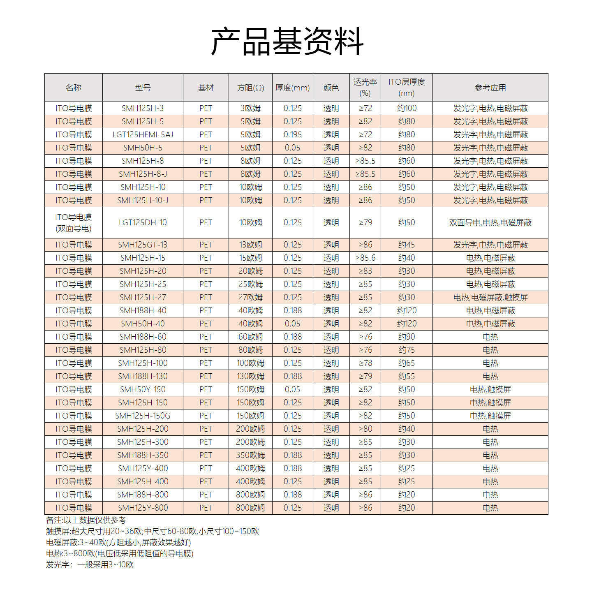

# 当时参考的ITO导电膜产品资料表
2026-09-30｜本人本轮提供原图并允许收入工作区；作为历史参考资料，不作为采购或实测证明。

[原样JPG](ITO导电膜产品资料表_本人提供_20260930.jpg)由本人从E盘QQ Files目录提供，原文件名a3996dcf6b3ecc3a2ab2be47c41a3abd.jpg。复制未改图，572205字节，SHA-256：
d127332c22559e9f3ef42c21ce04a48c00f57121a39695f4c489ba74bd506ad7。
源件与副本一致。图片题头为“产品基资料”，未显示厂家、网址或发行日期；本人确认这是当时参考的产品资料表。

## 与现有代码直接相关的行

以下是原图文字摘录。毫米“厚度”列与“ITO层厚度(nm)”为两个独立列；结合PET基材与代码支撑厚度使用方式，前者对应PET基膜/膜产品的标称厚度，不将其当ITO涂层厚度。原图没有进一步说明是否包含涂层总厚度。

| 型号（照录） | 基材 | 方阻（原表Ω） | 厚度mm | ITO层厚度nm | 与模型的关系 |
|---|---|---:|---:|---:|---|
| SMH188H-40 | PET | 40 | 0.188 | 约120 | 表内40档；不同于早期模型写的SMH125H-40 |
| SMH50H-40 | PET | 40 | 0.05 | 约120 | 表内另一40档；也不等于0.125 mm |
| SMH188H-60 | PET | 60 | 0.188 | 约90 | 与条带/拓扑及工字X设定的型号、标称片阻、支撑厚度对应 |
| SMH125H-80 | PET | 80 | 0.125 | 约75 | 与工字Y设定对应 |
| SMH125H-100 | PET | 100 | 0.125 | 约65 | 离散型号线索，不证明曾进入搜索 |
| SMH188H-130 | PET | 130 | 0.188 | 约55 | 与最终140.79不是同一标称片阻 |
| SMH125H-150 | PET | 150 | 0.125 | 约50 | 不将其视为最终140.79的已验证替代品 |
| SMH125H-200 | PET | 200 | 0.125 | 约40 | 表内离散型号 |
| SMH125H-300 | PET | **200（原表如此）** | 0.125 | 约30 | 型号后缀与方阻列不一致，保留原文待核 |

原表还有其他型号；这里没有将全部行转成新的“已可采购清单”。表末本身写“以上数据仅供参考”。厂商/版本、片阻公差、频率依赖、当前在售情况以及本人是否实际购买均未核实。本轮不需要为了恢复历史而推断当前采购条件。

这份附件补足“当时存在有限型号及厚度—片阻组合的参考依据”。它不能证明每个表中型号都被尝试，也不能解释何时决定放宽为连续双片阻。代码动态生成的SMH188H_*名称不等于这些连续数值都有对应商品。

新增差异：早期40档模型历史为SMH125H-40、PET厚0.125 mm，而本图没有这一行。可能是当时命名/输入差异、另一份资料或本表未列全；原因UNKNOWN，不替原图或模型更正。完整对照见[U02续核](../../../../公共资料/事实核验/本科毕设R1_20260930/U02_回忆与源文件续核.md)。

